<p align="center">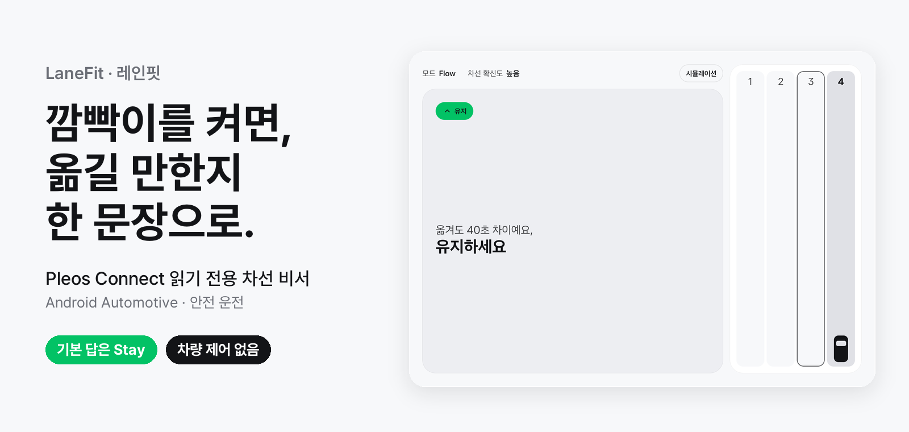</p>

<p align="center">
<b>방향지시등을 켜는 순간, "옮길 만한지"를 한 문장으로 답하는 Pleos Connect 차선 비서</b><br>
LaneFit 0.2.0 · 기본 답은 Stay · 차량 제어 없음
</p>

<p align="center">
<a href="#한눈에-보기">한눈에 보기</a> ·
<a href="#필요한-이유">필요한 이유</a> ·
<a href="#동작-방식">동작 방식</a> ·
<a href="#핵심-기능">핵심 기능</a> ·
<a href="#실제-도로-자료로-확인한-근거">데이터 근거</a> ·
<a href="#차량과-연결되는-지점">차량 연결</a> ·
<a href="#안전을-먼저-정한-설계">안전 설계</a> ·
<a href="#시장과-비즈니스">시장과 비즈니스</a> ·
<a href="#지원-범위">지원 범위</a> ·
<a href="#자료">자료</a>
</p>

---

> **안전 안내** 레인핏은 차량 신호를 읽기만 하고 차량을 제어하지 않습니다. 안내는 차로별 속도 정보입니다. 옆 차와의 간격은 운전자가 직접 확인하고, 차선을 바꿀지도 운전자가 결정합니다.

## 한눈에 보기

<p align="center">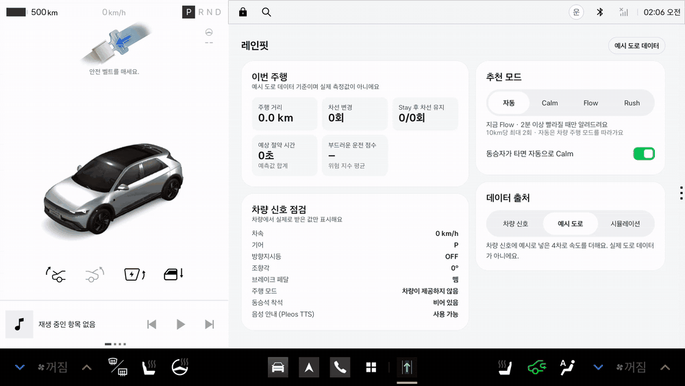</p>
<p align="center"><sub>계기판 옆 화면에서 방향지시등에 답하는 레인핏입니다. 시속 60km로 달리다 왼쪽 방향지시등을 켜면 카드가 "왼쪽이 2분 빨라요"라고 답하고, 차선 패널의 3차로에 "2분 빠름"이 표시됩니다. 차선을 옮긴 뒤에는 위험 지수가, 주차하면 주행 리포트가 이어집니다. 이 화면의 차로 속도는 표시된 대로 예시 도로 데이터입니다.</sub></p>

| 기본 답 | 운전자가 하는 일 | 차량에 보내는 명령 |
| :---: | :---: | :---: |
| **"옮겨도 40초 차이예요, 유지하세요"** | 방향지시등 켜기 | **없음** (읽기 전용) |

<p align="center">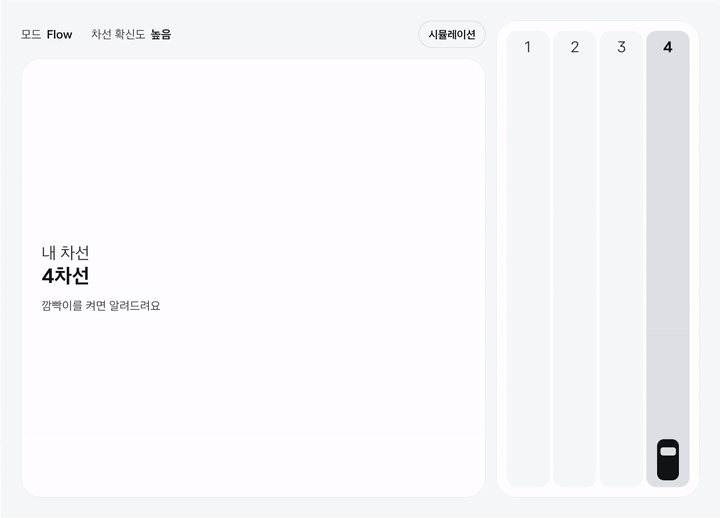</p>
<p align="center"><sub>앱에 내장된 66초 시뮬레이션 주행을 3배속으로 재생한 화면입니다. Stay 안내, 변경 안내, 위험 지수, 동승자 Calm, 주행 리포트가 차례로 나옵니다. 화면 속 속도와 시간은 시뮬레이션 값입니다.</sub></p>

## 필요한 이유

| 운전 중 생기는 문제 | 레인핏의 답 |
| --- | --- |
| 옆 차선이 **지금** 빨라 보이는 것과 **앞으로 10km**가 빠른 것은 다른 문제입니다. 운전자는 눈앞의 흐름만 봅니다. | 앞으로 10km에서 차로 간 예상 시간 차이를 계산해 알려 줍니다. |
| 내비게이션의 차로 안내는 "어느 차로로 가야 하나"에 답합니다. "지금 옮기면 이득인가"에는 답하지 않습니다. | 이득이 모드 기준에 못 미치면 **Stay**, 넘으면 얼마나 빠른지만 말합니다. |
| 신호를 얼마나 일찍 켰는지, 바꾼 직후 급하게 밟았는지는 차만 압니다. | 바꿀 때마다 0~100점 위험 지수와 한 줄 코칭을 보여 줍니다. |

도로교통법 시행령 별표 2는 진로를 바꾸기 전 **일반도로 30m, 고속도로 100m** 이상 지점부터 신호를 하도록 정합니다. 레인핏은 변경마다 이 거리를 계산해 기준과 함께 보여 줍니다. 레인핏은 내비게이션을 대신하지 않습니다. 어떤 내비게이션을 쓰든 그 옆에서 차선 단위 판단과 안전 코칭만 더합니다.

## 동작 방식

<p align="center">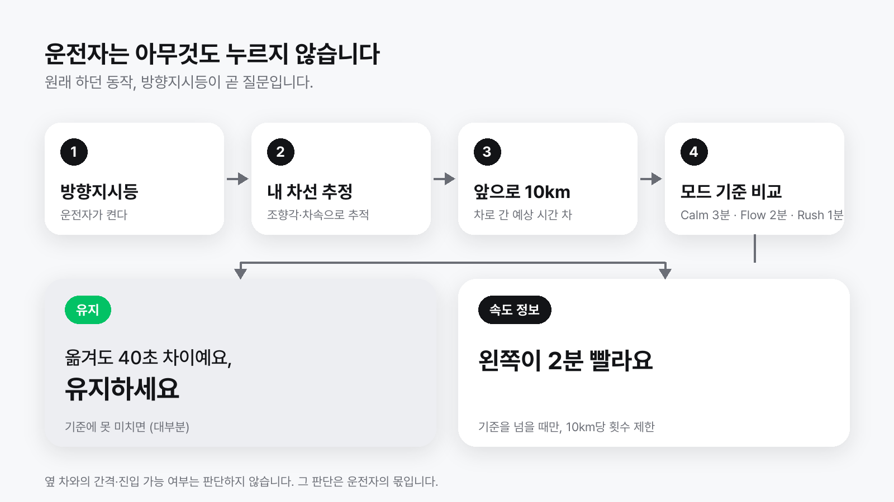</p>

1. **방향지시등이 질문입니다.** 주행 중에는 화면을 누르지 않습니다. 방향지시등을 켜면 그쪽 차로를 평가해 답합니다. 시속 10km 미만에서 켠 신호에는 차가 움직이기 시작할 때 한 번 답합니다.
2. **내 차선은 앱이 추정합니다.** 진입로 합류 지점과 음성으로 말한 차로를 기준점으로 잡고, 그 사이는 조향각과 차속으로 차선 이동을 추적합니다.
3. **앞으로 10km를 비교합니다.** 위치가 지원 구간에 들어오면 그 시각의 차로별 속도 프로필을 불러옵니다. 내 차로의 실제 속도(1분 이동평균)와 프로필의 비율(0.4~1.3배)로 모든 차로를 오늘 수준에 맞춥니다.
4. **답은 한 문장, 한 번입니다.** 예상 차이가 모드 기준에 못 미치면 "유지", 넘으면 얼마나 빠른지만 말합니다. 같은 문장을 화면에 크게 띄우고 음성으로 한 번 읽습니다.

다음 경우에는 방향지시등에 답하지 않고 침묵합니다.

- 내 차선 확신도가 0.6 미만이면 침묵합니다. 차로 수가 바뀌거나, 신호가 5초 넘게 끊기거나, 지원 구간을 5km 넘게 벗어났다 돌아오면 확신도를 내립니다.
- 경로 안내 때문에 켠 방향지시등에는 답하지 않습니다. 다음 기동이 가까이 있고 같은 방향이면 질문으로 보지 않습니다.
- 옆 차로가 버스전용차로이거나 차로 속도 자료가 없으면 침묵합니다.

## 핵심 기능

### 1. Stay 카드: 기본 답은 "유지하세요"

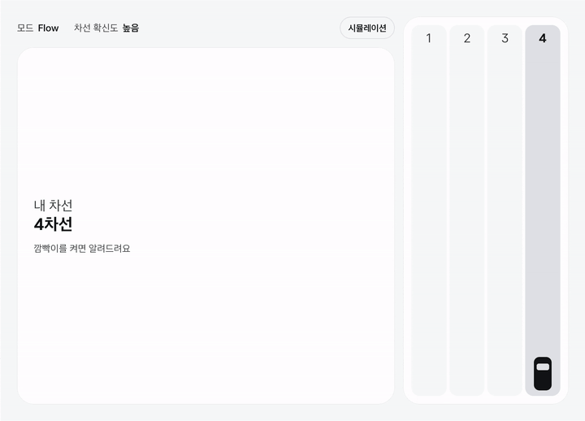

옆 차로가 10km에서 모드 기준 시간 이상 빠르고, 내 차선 확신도가 0.6 이상이고, 지금 차로를 60초 이상 유지했을 때만 변경을 안내합니다. 그 밖에는 "유지"로 답하거나 침묵합니다.

| 상황 | 화면과 음성의 답 |
| --- | --- |
| 옆 차로가 5초 이상 느림 | "왼쪽이 지금 더 느려요" |
| 차이가 5초 미만 | "차이가 거의 없어요, 유지하세요" |
| 차이가 모드 기준 미만 | "옮겨도 40초 차이예요, 유지하세요" |
| 기준 이상이지만 차선을 바꾼 지 60초 이내 | "방금 바꿨어요, 조금 더 유지하세요" |
| 기준 이상이지만 10km 안의 변경 안내 횟수가 상한에 도달 | "변경은 충분했어요, 이대로 가세요" |

### 2. 변경 안내와 변경 후 위험 지수


예상 차이가 기준을 넘으면 <b>"왼쪽이 2분 빨라요"</b>라고만 말하고, 그 아래에 "옆 차 간격은 직접 확인하세요"를 표시합니다. 운전자가 차선을 옮기면 조향각으로 이동을 감지해 내 차선을 고칩니다. 3초 뒤에는 "방금 변경의 위험 지수"와 한 줄 코칭을 띄웁니다.

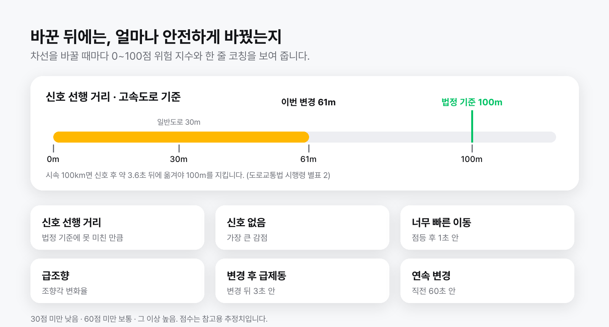

| 항목 | 점수 |
| --- | --- |
| 신호 선행 거리가 기준에 못 미침 | 못 미친 만큼, 최대 30점 |
| 방향지시등 없이 변경 | 40점 |
| 점등 후 1초 안에 이동 | 10점 |
| 급조향 | 최대 20점 |
| 변경 후 3초 안의 급제동 | 15점 |
| 직전 60초 안의 다른 변경 | 1회당 10점, 최대 20점 |

- 신호 선행 거리 기준은 고속도로 100m, 일반도로 30m입니다. 화면에는 "신호 선행 61m · 기준 100m"처럼 표시합니다.
- 30점 미만은 "낮음", 60점 미만은 "보통", 그 이상은 "높음"입니다. 등급은 글자, 아이콘, 세 칸 막대로 함께 알립니다.
- 코칭은 가장 큰 감점 항목 하나만 말합니다. 예를 들어 "신호를 조금 더 일찍 켜보세요", "핸들을 조금 더 천천히 돌려보세요", "변경 직후 급제동이 있었어요"라고 말합니다. 감점이 작으면 "부드럽게 바꿨어요"를 화면에만 표시합니다.
- 직전 변경의 위험 지수가 "높음"이면 자동 모드가 한 단계 차분한 쪽으로 내려갑니다.
- 위험 지수 아래에는 "참고용 추정치예요"를 항상 표시합니다.

### 3. 드라이브 모드와 동승자 Calm

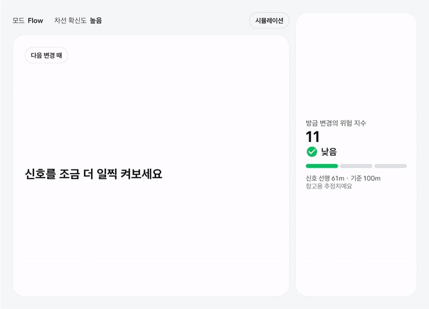

| 모드 | 변경 안내 기준 | 10km당 변경 안내 | 자동일 때 |
| :---: | :---: | :---: | --- |
| Calm | 3분(180초) 이상 | 1회 | ECO 주행 모드, 동승자 탑승 |
| Flow | 2분(120초) 이상 | 2회 | NORMAL 주행 모드 |
| Rush | 1분(60초) 이상 | 3회 | SPORT 주행 모드 |

- 10km 상한은 차선 변경 횟수가 아니라 **변경 안내** 횟수를 셉니다.
- "자동"은 차량 주행 모드를 따릅니다. 주차 화면의 "추천 모드"에서 Calm, Flow, Rush로 고정할 수 있습니다.
- 조수석이나 뒷좌석(왼쪽·가운데·오른쪽)에 사람이 앉으면 Calm으로 전환하고 <b>"Calm 모드로 바꿨어요"</b>, "3분 이상 빨라질 때만 알려드려요"를 표시합니다.
- 착석 신호는 탑승 여부만 알려 줍니다. 자동 전환은 주차 화면의 스위치 "동승자가 타면 자동으로 Calm"으로 끌 수 있습니다.

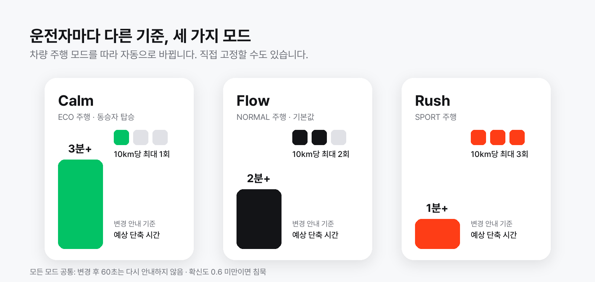

### 4. 음성으로 묻기

주차 화면의 스위치 <b>음성으로 묻기 · “지금 바꿀까?”</b>를 켜면 방향지시등 없이 말로 물을 수 있습니다. 기본 조작은 방향지시등입니다.

| 말 | 동작 |
| --- | --- |
| "지금 바꿀까?" | 양쪽 차로를 모두 평가해 더 나은 쪽으로 답합니다 |
| "왼쪽으로 갈까?" | 말한 쪽 차로만 평가합니다 |
| "지금 3차로야" | 차로 수를 아는 도로에서 내 차선을 3차로로 맞추고 "3차로로 맞췄어요"라고 답합니다. 도로의 차로 수보다 큰 숫자에는 "이 도로는 5차로까지예요"처럼 답합니다 |

- 양쪽이 모두 5초 이상 느리면 "지금 차선이 가장 빨라요, 유지하세요"라고 답합니다.
- 내 차선은 알지만 비교할 차로 자료가 없으면 "지금은 비교할 차로 자료가 없어요"라고 답합니다.
- 말로 물은 질문에는 경로 안내가 필요로 하는 방향이어도 답합니다.
- 마이크는 레인핏이 화면에 떠 있는 동안에만 엽니다. 음성 인식과 음성 안내는 온디바이스 모드로 동작합니다.

### 5. 주차하면 주행 리포트

기어를 P에 두면 "이번 주행" 리포트 화면으로 바뀝니다. 주행 거리, 차선 변경, Stay 후 차선 유지, 예상 절약 시간, 부드러운 운전 점수를 보여 줍니다. 부드러운 운전 점수는 100점에서 위험 지수 평균을 뺀 값이고, 예상 절약 시간은 예측값의 합계입니다. **빨리 간 것이 아니라 덜 바꾸고 부드럽게 바꾼 것을 칭찬합니다.**

추천 모드, 동승자 Calm, 음성으로 묻기, 데이터 출처 같은 모든 설정은 이 주차 화면에만 있습니다. "차량 신호 점검" 카드는 차량과 Pleos 서비스에서 실제로 받은 값만 표시합니다.

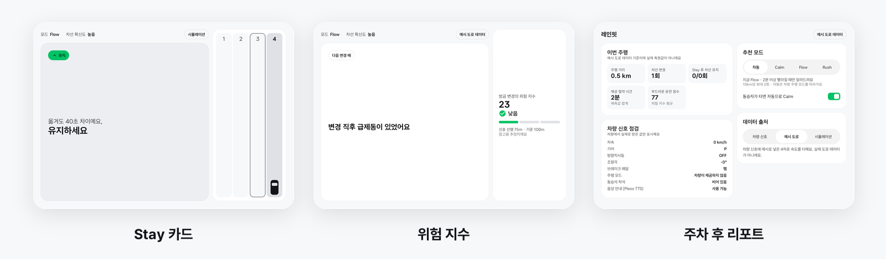

## 실제 도로 자료로 확인한 근거

한국도로공사 고속도로 공공데이터 포털의 AVC 차로별 15분 평균속도 15일치(2026-10-28~11-11)를 경부선 4개 지점에서 받아 계산했습니다. 같은 시각에 옆 차로로 옮겨 10km를 달릴 때 아끼는 시간입니다. 버스전용차로는 빼고, 15분당 승용차가 20대 이상인 칸만 썼습니다.

| 인접 차로 이동 | 이득 1분 미만 | 이득이 없거나 손해 | 실제 이득 중앙값 |
| :---: | :---: | :---: | :---: |
| 24,962건 | **86.9%** | 50.0% | 0.0초 |

옆 차로로 옮겨도 대부분 1분을 아끼지 못합니다. 그래서 레인핏의 기본 답은 "유지"입니다.

앱의 판단은 하루를 빼고 만든 프로필로 그날을 맞혀 보는 방식(leave-one-day-out)으로 확인했습니다. 앱과 같은 규칙으로 내 차로의 실제 속도에 수준을 맞춘 뒤 옆 차로 속도를 추정합니다. 예측 오차 중앙값은 23.9초입니다.

| 모드 | 판단 일치율 | 변경 안내 건수(비율) | 그중 실제 기준 이상 | 손해 아님 | 유지 판단 정확 | 실제 기준 초과 비율 |
| --- | :---: | :---: | :---: | :---: | :---: | :---: |
| Rush(60초) | 87.4% | 2,525 (10.1%) | 52.6% | 78.5% | 91.3% | 13.1% |
| Flow(120초) | **94.4%** | 1,091 (4.4%) | 57.0% | 82.1% | **96.1%** | 6.2% |
| Calm(180초) | 96.4% | 686 (2.7%) | 62.1% | 85.9% | 97.3% | 4.3% |

| 지점 | 구간 | 이동 건수 | 1분 미만 | 오차 중앙값 | Flow 일치율 |
| :---: | --- | :---: | :---: | :---: | :---: |
| 3908 | 기흥IC→수원신갈IC | 4,612 | 91.5% | 20.4초 | 97.0% |
| 3917 | 수원신갈IC→기흥IC | 6,326 | 96.1% | 15.5초 | 98.8% |
| 3962 | 신갈JC→서울TG | 7,584 | 83.4% | 29.4초 | 92.8% |
| 3961 | 서울TG→신갈JC | 6,440 | 78.6% | 36.2초 | 90.1% |

Flow 기준으로 앱의 유지 판단은 96.1% 맞습니다. 이 수치는 지점 속도(15분 평균)로 계산한 값입니다. 요약은 [docs/research/lane-profile-backtest.json](docs/research/lane-profile-backtest.json)에 있고, 아래 명령으로 다시 만듭니다.

```sh
python3 -I scripts/lane_profile.py fetch   # 공개 OpenAPI에서 원자료 받기
python3 -I scripts/lane_profile.py build   # 차로 속도 프로필과 백테스트 요약 만들기
```


<p align="center"><sub>하루 예시입니다. 신갈JC–서울TG 한 지점의 2026-11-10 자료이며, 이날 인접 차로 이동 492건 중 81.5%가 1분 미만이었습니다. 요약은 <a href="docs/research/avc-lane-gap.json">docs/research/avc-lane-gap.json</a>에 있습니다.</sub></p>

## 차량과 연결되는 지점

레인핏은 Pleos SDK 5종으로 차량과 연결됩니다. 모두 읽기 전용입니다.

| Pleos SDK | 권한 | 레인핏에서의 쓰임 |
| --- | --- | --- |
| Vehicle 2.3.2 | `pleos.car.permission.CAR_LIGHTS`<br>`pleos.car.permission.CAR_DRIVE`<br>`pleos.car.permission.CAR_SEATS` | 방향지시등(질문의 시작점, 신호 선행 거리), 조향각(차선 이동 추적, 급조향), 브레이크(변경 후 급제동), 주행 모드(추천 모드 자동 전환), 좌석 점유(동승자 Calm) |
| TextToSpeech 3.3.1 | `pleos.car.permission.TTS_SERVICE` | 한 문장 음성 안내 |
| NaviHelper 3.0.5 | `pleos.car.permission.NAVI_ROUTE` | 다음 기동의 방향과 거리. 경로 때문에 켠 방향지시등은 질문으로 보지 않습니다. 진입로 합류 직후 맨 오른쪽 차로를 기준점으로 잡고 진출입으로 고속도로 여부를 판단합니다 |
| FusedLocation 1.1.3 | `pleos.car.permission.FUSED_LOCATION` | 도로 구간 매칭(구간 직선 좌우 200m, 진행 방향 40도 이내). 차량 속도가 없을 때는 위치로 계산한 차속으로 대체합니다 |
| SpeechToText 3.3.1 | `pleos.car.permission.STT_SERVICE`<br>`android.permission.RECORD_AUDIO` | "지금 바꿀까?", "왼쪽으로 갈까?" 질문과 "지금 3차로야" 차로 지정 |

차속과 기어는 Android Automotive 차량 속성(`android.car.permission.CAR_SPEED`, `android.car.permission.CAR_POWERTRAIN`)으로 읽습니다. 방향지시등, 조향각, 브레이크, 주행 모드, 좌석 착석은 차량과 연동되지 않은 스마트폰 앱으로는 읽을 수 없는 신호입니다. 레인핏의 핵심 기능은 이 신호 위에서 성립합니다.

## 안전을 먼저 정한 설계

- **속도 정보만 말합니다.** 옆 차와 간격이 충분한지, 지금 들어가도 되는지는 판단하지 않습니다. 차선 패널에도 다른 차는 그리지 않습니다.
- **한 문장, 한 번입니다.** 방향지시등을 켠 직후에 한 번만 답합니다.
- **모르면 침묵합니다.** 내 차선 확신도가 0.6 미만이면 답하지 않습니다.
- **주행 중에는 누를 것이 없습니다.** 버튼과 설정은 주차 화면에만 있습니다.
- **읽기 전용입니다.** 차량 제어(CONTROL) 권한을 쓰지 않습니다.
- **변경을 부추기지 않습니다.** 변경 안내는 10km당 모드별 상한을 넘지 않고 변경 직후 60초 동안은 변경을 안내하지 않습니다.
- **출처를 숨기지 않습니다.** 차량이 아닌 값(예시 도로 데이터, 시뮬레이션)에는 화면에 출처를 표시합니다.

## Pleos 디자인 가이드를 따른 화면

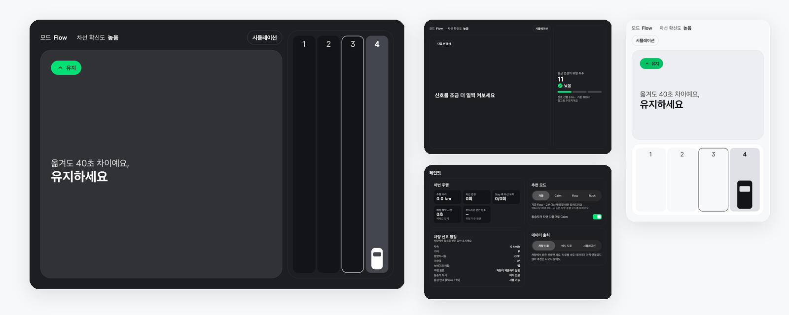

Pleos Connect 디자인 가이드의 색 토큰, 타입 스케일, 컴포넌트 치수를 적용합니다. 주야간 전환과 가로·세로 창을 모두 지원합니다. 가로 창에서는 문장 카드와 차선 패널을 나란히, 세로 창에서는 위아래로 배치합니다. 주행 중 가장 큰 글자는 Stay 문장과 위험 지수 점수에 씁니다. 답이 바뀔 때의 모션은 한 번만 재생하고 시스템 애니메이션 설정을 따릅니다. 질문한 차로의 테두리만 답이 떠 있는 동안 깜빡입니다. 적용값은 [docs/design/DESIGN.md](docs/design/DESIGN.md)에 있습니다.

## 시장과 비즈니스

이 절의 수치와 수익 모델은 사업 추정이며 측정값이 아닙니다.

### 타깃

| 사용자 | 레인핏이 맞는 이유 |
| --- | --- |
| 고속도로·도시고속도로 출퇴근 운전자 | 같은 길을 매일 반복하는 습관형 사용 |
| 가족을 태우는 운전자 | 동승자 Calm의 주 사용자 |
| 장거리·업무용 차량 운전자 | 변경 횟수와 위험 지수 관리 |

### 예상 MAU (추정)

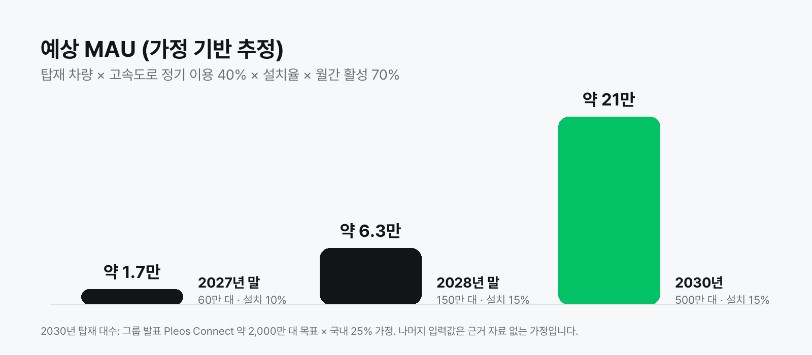

탑재 차량 수, 고속도로 정기 이용 비율, 설치율, 월간 활성 비율을 곱한 추정입니다. 2027년 말 약 1.7만, 2028년 말 약 6.3만, 2030년 약 21만입니다. 모든 입력값은 계산 구조를 보이기 위한 가정입니다. 리텐션은 30일 40%, 주 3회 이상 사용자 50%를 목표값으로 둡니다(추정, 측정값 아님).

### 수익 모델 (추정)

| 모델 | 내용 |
| --- | --- |
| 월 구독 | 상세 리포트, 반복 경로의 개인화 예측 |
| 데이터 제공 | 익명 집계한 차로 단위 흐름을 도로 운영 기관·내비게이션·물류 사업자에 제공 |

수익은 차선 변경 횟수와 연결되지 않습니다. 차선을 많이 바꿀수록 수익이 느는 구조는 두지 않습니다.

## 지원 범위

| 항목 | 지원 범위 |
| --- | --- |
| 플랫폼 | Pleos Connect(Android Automotive), Android 10(API 29) 이상 |
| 차로 속도 프로필 | 경부선 기흥IC~서울TG 4개 구간: 기흥IC→수원신갈IC, 수원신갈IC→기흥IC, 신갈JC→서울TG, 서울TG→신갈JC. 평일/주말, 15분 칸, 차로별 |
| 그 밖의 도로 | 차선 변경 안내 없이 침묵(유지). 변경 후 위험 지수와 주행 리포트는 동작 |
| 버스전용차로, 자료가 없는 칸 | 추천하지 않음 |
| 동승자 좌석 | 조수석, 뒷좌석 왼쪽·가운데·오른쪽 |
| 데이터 출처 | 차량 신호(기본), 예시 도로, 66초 시뮬레이션. 차량이 아닌 값은 화면에 출처 표시 |
| 화면 | 가로·세로 창, 주야간 |
| 언어 | 한국어 화면과 음성 |
| 차량 제어 | 없음. 읽기 전용 |

차로 속도 프로필은 `app/src/main/assets/lane_profile.txt`로 앱에 내장돼 있습니다. 주행 추적과 음성 질문은 레인핏이 화면에 떠 있는 동안 동작합니다.

## 빌드와 실행

```sh
./gradlew :app:testDebugUnitTest :app:assembleDebug :app:assembleRelease
```

JVM 단위 테스트 27개(EngineTest 16, DriveSessionTest 11)가 함께 실행됩니다. 필요 환경, 설치, 실행 방법은 [docs/DEVELOPMENT.md](docs/DEVELOPMENT.md)에 있습니다.

## 자료

| 자료 | 위치 |
| --- | --- |
| 서명된 release APK | [apk/양주쀼_LaneFit_release.apk](apk/양주쀼_LaneFit_release.apk) |
| 빌드·실행 | [docs/DEVELOPMENT.md](docs/DEVELOPMENT.md) |
| 서비스 소개 본문 | [docs/submission/proposal.md](docs/submission/proposal.md) |
| 디자인 적용값과 전체 화면 캡처 | [docs/design/DESIGN.md](docs/design/DESIGN.md) · [docs/design/screens](docs/design/screens) |
| Pleos SDK 참고 자료 | [docs/research/pleos-sdk.md](docs/research/pleos-sdk.md) |
| 데이터 분석과 백테스트 | [docs/research/backtest.md](docs/research/backtest.md) |
| 15일 백테스트 요약(JSON) | [docs/research/lane-profile-backtest.json](docs/research/lane-profile-backtest.json) |
| 차로 속도 프로필·백테스트 코드 | [scripts/lane_profile.py](scripts/lane_profile.py) |
| 도로 카메라 영상 흐름 분석 도구(차로별 상대 속도·통과 대수) | [scripts/analyze_cctv.py](scripts/analyze_cctv.py) |
| 소개 영상 | [docs/media/video](docs/media/video) |
| 변경 이력 | [CHANGELOG.md](CHANGELOG.md) |

<p align="center"><sub>LaneFit · Kotlin · Jetpack Compose · Pleos Vehicle SDK · Pleos TextToSpeech SDK · Pleos NaviHelper SDK · Pleos FusedLocation SDK · Pleos SpeechToText SDK</sub></p>
