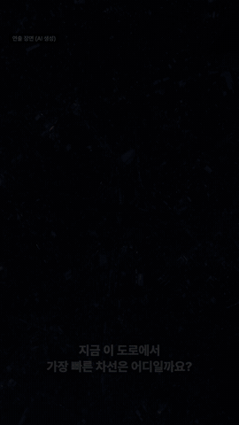
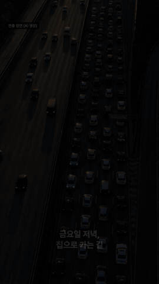
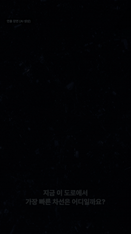
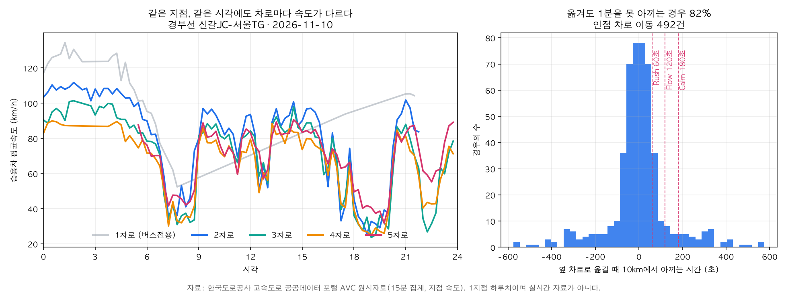
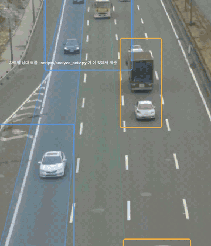

<b>방향지시등을 켜는 순간, "옮길 만한지"를 한 문장으로 답하는 Pleos Connect 차선 비서</b> 
현대자동차그룹 차량용 앱 개발 공모전 · 안전 운전 부문 · 팀 양주쀼

<a href="#한눈에-보기">한눈에 보기</a> ·
<a href="#왜-필요한가">왜 필요한가</a> ·
<a href="#어떻게-동작하나">어떻게 동작하나</a> ·
<a href="#핵심-기능">핵심 기능</a> ·
<a href="#실제-도로-자료로-확인한-근거">데이터 근거</a> ·
<a href="#데이터와-ai-기술">데이터·AI 기술</a> ·
<a href="#소개-영상">영상</a> ·
<a href="#왜-차-안이어야-하나">왜 차 안인가</a> ·
<a href="#시장과-비즈니스">시장과 비즈니스</a> ·
<a href="#로드맵">로드맵</a>

---

## 한눈에 보기

Pleos Connect Emulator에서 실행한 실제 앱 화면. 66초 시뮬레이션 주행을 3배속으로 줄였습니다. 화면 속 속도와 시간은 예시 값입니다.

| 이 앱이 가장 자주 하는 말 | 운전자가 하는 일 | 차량에 보내는 명령 |
| :---: | :---: | :---: |
| **"옮겨도 40초 차이예요, 유지하세요"** | 방향지시등을 켠다. 끝 | **없음.** 신호를 읽기만 한다 |

## 소개 영상

| 「도로는 이미 알고 있다」 46초 | 「아빠의 깜빡이」 45초 | 30초 컷 |
| :---: | :---: | :---: |
|  |  |  |
| 데이터와 AI로 설득 | 가족과 안전으로 설득 | 숏폼 피드용 |

미리보기를 누르면 소리가 있는 MP4가 열립니다. 앱 화면은 에뮬레이터 실제 녹화, 그래프는 한국도로공사 공개 자료입니다. 인물·도로 장면은 AI로 만든 연출이고 화면마다 표기했습니다. 편집 코드는 <a href="video">video/</a>, 컷 구성은 <a href="video/STORYBOARD.md">STORYBOARD.md</a>에 있습니다.

## 왜 필요한가

> 매일 아침 도시고속도로. 옆 차선이 빨라 보여서 옮겼더니 방금 떠난 차선이 뚫린다. 다시 옮긴다. 도착해 보면 몇 번을 바꿨는지 기억도 안 나고, 그래서 빨리 왔는지도 모르겠다.

> 아이를 태우고 가는 길. 출구를 앞두고 급하게 끼어들었다. 뒤차가 경적을 울렸고 아이가 놀랐다. 방향지시등을 켜긴 했는데, 충분히 일찍 켰는지는 알 방법이 없다.

| 지금의 불편 | 레인핏의 답 |
| --- | --- |
| 옆 차선이 **지금** 빨라 보이는 것과 **앞으로 몇 km** 빠른 것은 다른 문제인데, 운전자는 눈앞의 흐름만 본다 | 앞으로 10km 구간의 차로 간 예상 시간 차이를 계산해 알려 준다 |
| 내비게이션의 차로 안내는 "어느 차로로 가야 하나"에 답한다. "지금 옮기면 이득인가"에는 답하지 않는다 | 이득이 모드 기준에 못 미치면 **Stay**, 넘으면 얼마나 빠른지만 말한다 |
| 신호를 얼마나 일찍 켰는지, 바꾼 직후 급하게 밟았는지는 차만 알고 운전자는 모른다 | 바꿀 때마다 0~100점 위험 지수와 한 줄 코칭을 보여 준다 |

도로교통법 시행령 별표 2는 진로를 바꾸기 전 **일반도로 30m, 고속도로 100m** 이상 지점부터 신호를 하도록 정한다. 하지만 운전 중에 이 거리를 지켰는지 알려 주는 도구는 없다. 이득이 거의 없는 변경을 줄이면 옆 차와 가까워지는 순간 자체가 줄어든다.

## 어떻게 동작하나

1. **방향지시등이 곧 질문이다.** 화면 터치도, 음성 호출도 없다. 운전자가 원래 하던 동작을 "바꾸려는 의도"로 읽는다.
2. **내 차선은 앱이 추정한다.** 진입로 합류처럼 차선이 확실한 지점을 기준점으로 잡고 그 사이는 조향각과 차속으로 이동을 따라간다.
3. **확신이 없으면 침묵한다.** 내 차선 확신도가 0.6 아래로 떨어지면 아무 말도 하지 않는다.
4. **답은 한 문장, 한 번.** 점등 직후 한 번만 말하고 같은 문장을 화면에 크게 띄운다.

## 핵심 기능

### 1. Stay 카드: 기본 답은 "유지하세요"

옮겨도 이득이 모드 기준에 못 미치면 **"옮겨도 40초 차이예요, 유지하세요"**라고 답한다. 변경 안내보다 Stay가 훨씬 자주 나오도록 설계했다. 덜 바꿔도 늦지 않는다는 확신을 주는 것이 레인핏의 첫 번째 일이다.

### 2. 옮길 만할 때, 그리고 옮긴 뒤의 위험 지수

예상 차이가 기준을 넘으면 **"왼쪽이 2분 빨라요"**라고만 말한다. 옆 차와의 간격은 운전자가 직접 확인한다. 운전자가 차선을 옮기면 앱이 조향각으로 이동을 감지해 현재 차로를 고친다. 3초 뒤에는 위험 지수와 한 줄 코칭을 띄운다.

### 3. 드라이브 모드와 동승자 모드

조수석에 동승자가 타면 **"Calm 모드로 바뀌었어요."** 이제 3분 이상 차이 날 때만 변경을 안내한다. 착석 신호는 탑승 여부만 알려 주므로 자동 전환은 주차 화면에서 끌 수 있다.

### 4. 주차하면 주행 리포트

기어를 P에 두면 리포트 화면으로 바뀐다. Stay 안내 뒤 유지한 횟수, 차선 변경 횟수, 부드러운 운전 점수를 보여 준다. **빨리 간 것이 아니라 덜 바꾸고 부드럽게 바꾼 것을 칭찬한다.**

## 실제 도로 자료로 확인한 근거

한국도로공사 공개 OpenAPI에서 경부선 신갈JC–서울TG 한 지점의 차로별 15분 평균속도 하루치(2026-11-10)를 받아 계산했다. 같은 시각에 옆 차로로 옮겨 10km를 달린다고 가정했을 때 아끼는 시간이다.

| 인접 차로 이동 | 1분도 못 아낀 경우 | 이득이 없거나 손해 | 이득 중앙값 |
| :---: | :---: | :---: | :---: |
| 492건 | **81.5%** | 50% | 0.5초 |

모드 기준을 넘는 경우는 Rush(1분) 18.5%, Flow(2분) 10.0%, Calm(3분) 7.7%였다. 대부분은 옮겨도 이득이 없고, 가끔 크게 벌어진다(최대는 08:45, 3→2차로 약 9분 36초). 그래서 기본 답을 "유지하세요"로 두고 차이가 클 때만 말한다.

한 지점의 지점 속도 하루치라서 구간 통행시간도 실시간도 아니다. 재현: `uv run -q --with matplotlib python -I scripts/analyze_avc.py` · 요약 [docs/research/avc-lane-gap.json](docs/research/avc-lane-gap.json)

## 데이터와 AI 기술

도로 카메라 영상 분석 구상. 화면은 AI로 만든 연출 영상이고, 겹쳐 그린 상자와 막대는 <code>scripts/analyze_cctv.py</code>가 이 컷에서 계산한 값입니다.

레인핏의 판단은 세 가지 입력으로 만든다.

| 입력 | 하는 일 | 지금 | 코드 |
| --- | --- | --- | --- |
| 차량 신호 | 방향지시등·조향각·브레이크·착석·차속으로 의도, 내 차선, 변경 뒤 위험 지수를 계산 | 앱에서 동작 | [app/](app) |
| 차로별 통행속도 | 차로 사이 속도 차로 "앞으로 10km에서 몇 초"를 계산 | 실제 자료 1지점 하루 분석 완료. 앱은 예시 값 | [scripts/analyze_avc.py](scripts/analyze_avc.py) |
| 도로 카메라 영상 | 고정 카메라 영상에서 차로별 흐름(상대 속도, 통과 대수)을 읽어 실시간 값을 채움 | 분석 코드와 자체 검증. 앱 연결은 다음 단계 | [scripts/analyze_cctv.py](scripts/analyze_cctv.py) |

**도로 카메라 영상 분석.** 차로마다 영역을 잡고 연속 프레임의 광학 흐름(Farneback)에서 진행 방향으로 움직이는 화소만 골라 차로별 중앙 속도를 구한다. 통과 대수는 차로 가운데 검지선의 점유가 켜지는 횟수로 센다. 정답을 아는 합성 3차로 영상에서 속도 오차 0%, 대수 일치를 확인했다(`--selftest`). 국가교통정보센터의 경부선 실제 야간 영상 30초에도 돌려 봤는데, 전조등 빛 번짐 때문에 통과 대수가 실제보다 많이 잡혔다. 실사용에는 낮 영상, 차량 검출 모델, 카메라별 차로 보정이 필요하다. 실제 CCTV 영상은 저작권 정책에 따라 저장소와 영상에 넣지 않았다.

**실시간으로 가는 길.** 과거 차로별 속도로 시간대별 "차로 간 속도 차" 프로필을 만들고, 실시간 구간 속도와 카메라 흐름으로 지금 수준에 맞춘다. 자료가 없거나 차이가 작으면 Stay로 답하거나 침묵한다.

## 왜 차 안이어야 하나

| 차량 신호 | 레인핏에서의 쓰임 | 스마트폰 앱 |
| --- | --- | :---: |
| 방향지시등 | 질문의 시작점, 신호 선행 거리 계산 | 읽을 수 없음 |
| 조향각 | 차선 이동 추적, 급조향 판단 | 읽을 수 없음 |
| 브레이크 | 변경 후 급제동 판단 | 읽을 수 없음 |
| 주행 모드 | 추천 강도 자동 전환 | 읽을 수 없음 |
| 좌석 착석 | 동승자 모드 | 읽을 수 없음 |

차량과 연동되지 않은 스마트폰 앱은 다섯 신호 중 어느 것도 읽지 못한다. 레인핏은 Pleos Vehicle SDK로 이 신호를 읽는다. 신호가 없으면 핵심 기능이 성립하지 않는다. **"차에서만 되는 앱"의 사례**다.

레인핏은 내비게이션을 대신하지 않는다. 어떤 내비게이션을 쓰든 그 옆에서 차선 단위 판단과 안전 코칭만 더한다.

### 안전을 먼저 정한 설계

- **속도 정보만 말한다.** 옆 차와의 간격이 충분한지, 지금 들어가도 되는지는 판단하지 않는다.
- **한 문장, 한 번.** 점등 직후에만 말한다.
- **모르면 침묵.** 내 차선 확신도가 낮으면 답하지 않는다.
- **주행 중 터치 없음.** 버튼과 설정은 주차 화면에만 둔다.
- **읽기 전용.** 차량 제어(CONTROL) 권한을 요청하지 않는다.
- **변경을 부추기지 않는다.** 수익은 구독에서 나온다. 차선을 많이 바꿀수록 돈이 되는 구조는 두지 않는다.

### Pleos 디자인 가이드를 따른 화면

Pleos Connect 디자인 가이드의 색 토큰, 타입 스케일, 컴포넌트 치수를 적용했다. 주야간 전환과 가로·세로 창을 모두 지원한다. 주행 중 가장 큰 글자는 Stay 문장에 쓴다.

## 시장과 비즈니스

### 타깃

| 사용자 | 레인핏이 맞는 이유 |
| --- | --- |
| 고속도로·도시고속도로 출퇴근 운전자 | 같은 길을 매일 반복해서 습관형 사용에 맞다 |
| 가족을 태우는 운전자 | 동승자 모드의 주 사용자 |
| 장거리·업무용 차량 운전자 | 변경 횟수와 위험 지수를 관리하는 효과가 크다 |

### 예상 MAU

모든 입력값은 계산 구조를 보이기 위한 가정이다. 리텐션 목표는 30일 40%, 주 3회 이상 사용자 50%다(측정값 아님). 앱을 따로 열지 않아도 매 주행에서 방향지시등과 주행 모드로 동작한다. 주행마다 리포트가 쌓여 "지난주보다 덜 바꿨는지"를 보여 준다.

### 수익 모델

| 모델 | 내용 | 시점 |
| --- | --- | --- |
| 월 구독 | 상세 리포트, 반복 경로의 개인화 예측 | 출시 |
| 데이터 제공 | 익명 집계한 차로 단위 흐름을 도로 운영 기관·내비게이션·물류 사업자에 제공 | 확장 단계 |

## 로드맵

| 시점 | 할 일 |
| --- | --- |
| 접수 마감 (11/15) | 에뮬레이터에서 동작하는 앱, 시연 영상, release APK |
| PT 심사 (12/3~4) 전 | 차로별 통행속도 분석을 여러 지점·여러 날로 확대, 낮 시간 도로 카메라 영상으로 흐름 분석 보정, SDK 연동 확대 |
| 수상 이후 | 실도로 파일럿, 가중치와 모드 기준 조정 |
| 확장 | 출구 대비 안내, 전기차 전비 연동, 주간·월간 리포트, Gleo AI 연동("지금 차선 바꿀까?"), 익명 집단 데이터로 예측 보정 |

차로별 속도는 과거 통행속도 프로필과 실시간 구간 속도, 도로 카메라 흐름을 합쳐 만든다. 실제 자료에서 "대부분의 변경은 이득이 없다"는 결과가 나왔고, 이것이 Stay 카드의 근거다.

## 지금의 상태

레인핏은 공모전 제출용 프로토타입이다. **실도로 운전 판단에 쓰지 마세요.**

- Pleos Connect Emulator v2.1.0에서 방향지시등·조향각·브레이크·조수석 착석(Vehicle SDK), 차속·기어(AAOS) 신호를 받아 동작하는 것을 확인했다.
- 차로별 속도와 시작 차선은 아직 예시 값이다. 위험 지수와 모드 기준은 실주행 자료로 맞출 초기 설계값이다.
- 화면에는 데이터 출처(차량 신호 / 예시 도로 / 시뮬레이션)를 항상 표시한다.

## 자료

| 자료 | 위치 |
| --- | --- |
| 제출용 서명 APK | [apk/양주쀼_LaneFit_release.apk](apk/양주쀼_LaneFit_release.apk) |
| 빌드·실행·검증 상태 | [docs/DEVELOPMENT.md](docs/DEVELOPMENT.md) |
| 프로젝트 소개 본문 | [docs/submission/proposal.md](docs/submission/proposal.md) |
| 디자인 적용값과 전체 화면 캡처 | [docs/design/DESIGN.md](docs/design/DESIGN.md) · [docs/design/screens](docs/design/screens) |
| SDK 조사와 데이터 분석 | [docs/research/pleos-sdk.md](docs/research/pleos-sdk.md) · [docs/research/backtest.md](docs/research/backtest.md) |
| 숏폼 3편과 편집 코드 | [docs/media/video](docs/media/video) · [video/](video) |
| 변경 이력 | [CHANGELOG.md](CHANGELOG.md) |

LaneFit · 팀 양주쀼 · Kotlin · Jetpack Compose · Pleos Vehicle SDK · Pleos TextToSpeech SDK

