# LaneFit 디자인 스펙

화면은 Pleos Connect 디자인 시스템의 토큰과 치수를 따른다. 이 문서는 앱에 실제로 들어간 값만 적는다. 구현은 `app/src/main/java/app/lanefit/ui/Pleos.kt`(토큰, 타입 스케일)와 `ui/LaneFitApp.kt`(화면)다.

## 0. 출처와 확인 범위

| 자료 | 무엇으로 썼나 |
| --- | --- |
| Pleos Connect 디자인 가이드 (`https://document.pleos.ai/docs/connect/guide/docs-design/Introduction/intro` 이하) | 기준. 색 토큰 표와 타입 스케일 이미지를 직접 열어 아래 값과 대조했다 |
| `github.com/luffy-pleos-connect/pleos-connect-design-system` (커밋 `b38e3df`) | 참고. Pleos·42dot 공식 조직의 저장소가 아니라 가이드에서 토큰을 옮겨 적은 제3자 저장소다. 라이선스가 없어 코드는 가져오지 않았고, 값만 공식 가이드와 맞춰 본 뒤 직접 구현했다 |
| Pleos Connect Emulator v2.1.0 | 실제 렌더 확인. 아래 캡처는 전부 이 에뮬레이터 화면이다 |

확인한 것과 못 한 것:

- 대조함: surface, informative, background 색 표, title·body 타입 스케일.
- 열어 보지 못함: 공식 Figma 파일, headline·label 타입 이미지, text·switch·button 색 표. 이 값들은 참고 저장소의 값을 썼고 공식 원본과 대조하지 못했다.
- 가이드 안의 불일치: background 표는 라벨(primary = basic_50)과 색 견본이 서로 다르다. 라벨을 따랐다.

## 1. 방향

- 주행 중 화면은 문장 하나만 보여 준다. 답은 음성이 먼저 하고, 화면은 확인용이다.
- 주인공은 Stay 카드다. 앱에서 가장 큰 글자(Headline L)와 유일한 색 채움(유지 알약)을 Stay 가 쓴다. 변경 정보는 한 단계 작은 글자(Headline S)에 색 없이 쓴다.
- 색은 시스템 토큰만 쓴다. 앱 고유 색은 없다. 속도계, 게이지, 순위, 배지처럼 경쟁을 부르는 모양은 쓰지 않는다.
- 주행 중에는 터치할 것이 없다. 버튼, 스크롤, 탭은 전부 주차 화면에 있다.
- 장식 모션이 없다. 카드는 바뀔 때 그냥 바뀐다.

## 2. 색 토큰

주야간은 시스템 설정(`isSystemInDarkTheme()`)을 따른다. `regulation_*` 토큰은 쓰지 않는다.

| 앱에서 쓰는 이름 | Pleos 토큰 | Light | Dark | 쓰는 곳 |
| --- | --- | --- | --- | --- |
| `backgroundPrimary` | background_primary | `#F7F8FA` | `#1D1E21` | 창 바탕 |
| `surfaceBasic` | surface_basic | `#FFFFFF` | `#1D1E21` | 카드 |
| `surfaceLow` | surface_low | `#F7F8FA` | `#131417` | 타일, 차선 칸 |
| `surfaceHigh` | surface_high | `#EDEEF2` | `#313236` | Stay 카드 바탕 |
| `surfaceAccent` | surface_accent | `#E0E1E6` | `#44464E` | 내 차선 칸, 빈 눈금 |
| `textPrimary` | text_primary | `#131417` | `#FFFFFF` | 읽어야 하는 글자 |
| `textSecondary` | text_secondary | primary 84% | primary 84% | 보조 문장 |
| `textTertiary` | text_tertiary | primary 64% | primary 64% | 라벨, 설명 |
| `border` | alpha_dark_100 / alpha_light_100 | primary 10% | primary 10% | 카드 테두리 1dp |
| `controllerTabBackground` | alpha_dark_50 / alpha_light_50 | primary 5% | primary 5% | Segmented 바탕 |
| `buttonSwitchEnabled` | button_switch_enabled | `#FFFFFF` | 흰색 20% | Segmented 선택 칩 |
| `switchOff` | — | `#131417` 30% | 흰색 10% | Switch 꺼짐 트랙 |
| `informativeActive` | informative_active | `#02C265` | `#00E074` | 유지 알약, Switch 켜짐, 위험 "낮음" |
| `informativeNegative` | informative_negative | `#FE3D16` | `#FF4C28` | 위험 "높음" |
| `StaticDark` | static_dark | `#131417` | `#131417` | 채운 알약 위 글자 |

대비(WCAG 2.x 계산값):

| 조합 | Light | Dark |
| --- | --- | --- |
| textPrimary / 카드 | 18.4:1 | 16.7:1 |
| textTertiary / 카드 | 5.5:1 | 7.5:1 |
| textTertiary / surfaceHigh | 5.2:1 | 6.3:1 |
| StaticDark / 유지 알약 | 7.8:1 | 10.5:1 |
| informativeActive 아이콘 / 카드 | 2.4:1 | 9.5:1 |
| informativeNegative 아이콘 / 카드 | 3.6:1 | 5.0:1 |

밝은 테마에서 초록 아이콘과 눈금은 3:1 에 못 미친다. 그래서 위험 단계는 색만으로 전달하지 않는다. 단계 글자(낮음·보통·높음), 아이콘 모양(체크·정보·경고), 3칸 눈금의 위치가 같은 뜻을 함께 전한다.

## 3. 글자

글꼴은 헤드유닛의 시스템 글꼴 Asta Sans 다(글꼴 이름 `pretendard` 로 불러온다). 앱에 글꼴 파일을 넣지 않았다. 굵기는 Regular 400, Bold 600, ExtraBold 800 을 쓴다.

| 스타일 | 크기/행간 (sp) | 굵기 |
| --- | --- | --- |
| Headline L | 60 / 78 | 800 |
| Headline S | 48 / 62 | 800 |
| Title L | 40 / 52 | 800 |
| Title M | 36 / 47 | 600 |
| Title S | 32 / 42 | 600 |
| Body L | 30 / 45 | 400 / 600 |
| Body M | 28 / 42 | 400 / 600 |
| Body S | 26 / 39 | 400 / 600 |
| Label M | 24 / 36 | 400 |

Stay 판정("유지하세요")과 위험 점수가 Headline L 로 가장 크다. Stay 의 앞절("옮겨도 40초 차이예요,")은 Title L 을 Regular 로 낮춰 판정만 눈에 들어오게 했다.

## 4. 치수

| 요소 | 값 |
| --- | --- |
| 창 여백 | 폭 1000dp 이상 48dp, 미만 32dp |
| 요소 간격 | 24dp |
| 카드 | 모서리 48dp, 테두리 1dp, 그림자 없음. 안쪽 여백 48dp(메시지), 40dp(위험), 24dp(차선) |
| 타일 | 모서리 24dp, 안쪽 여백 24dp |
| 알약 | 높이 64dp, 좌우 여백 24dp, 아이콘 36dp |
| Segmented | 높이 100dp, 안쪽 여백 8dp, 선택 칩 높이 84dp |
| Switch | 트랙 80×48dp 모서리 16dp, 노브 32dp 모서리 8dp, 여백 8dp. 행 전체(높이 80dp 이상)가 터치 영역 |
| 위험 눈금 | 3칸, 높이 16dp, 모서리 8dp |

터치 대상은 모두 80dp 이상이다(Segmented 칩 84dp, Switch 행 80dp).

## 5. 화면

### 5.1 주행 화면

터치 요소가 없다. 맨 위에 상태 줄(모드, 차선 확신도 낮음·보통·높음)과 데이터 출처 알약이 있고, 그 아래 메시지 카드와 차선 패널이 있다.

| 상태 | 메시지 카드 | 옆 패널 |
| --- | --- | --- |
| 대기 | "내 차선 / N차선 / 깜빡이를 켜면 알려드려요". 확신도가 낮으면 "추천 쉬는 중" | 차선 패널, 내 차선 강조 |
| Stay | 채운 "유지" 알약, 앞절 + 판정. 바탕 surfaceHigh | 물어본 차선에 3dp 테두리 |
| 변경 정보 | "속도 정보" 알약 + 문장 + "옆 차 간격은 직접 확인하세요" | 물어본 차선에 "N분 빠름" |
| 위험 지수 | "다음 변경 때" 또는 "방금 변경" 알약 + 코칭 한 줄 | 점수, 아이콘 + 단계 글자, 3칸 눈금, "신호 선행 Nm · 기준 100m", "참고용 추정치예요" |
| 동승자 | "동승자 탑승" 알약 + "Calm 모드로 바꿨어요" + 새 기준 | 차선 패널 |

- 카드는 8초 동안 떠 있다가 대기로 돌아간다.
- 차선 패널에는 내 차만 그린다. 다른 차는 그리지 않는다. 앱이 주변 차량을 모르기 때문이다.
- 변경 정보 카드는 색 채움이 없고 항상 "옆 차 간격은 직접 확인하세요"가 붙는다. 앱은 차간 간격이 안전한지 판단하지 않는다.
- 위험 지수 구간: 30 미만 낮음, 60 미만 보통, 그 이상 높음. 가중치는 검증 전 설계값이라 화면에 "참고용 추정치예요"라고 적는다.

### 5.2 주차 화면

기어 P(기어 신호가 없으면 정지 3초)에서만 나온다. 설정과 리포트가 전부 여기 있다.

| 카드 | 내용 |
| --- | --- |
| 이번 주행 | 주행 거리, 차선 변경, Stay 후 차선 유지, 예상 절약 시간(예측값 합계), 부드러운 운전 점수(위험 지수 평균). 출처가 차량 신호가 아니면 "실제 측정값이 아니에요"를 적는다 |
| 추천 모드 | Segmented 자동·Calm·Flow·Rush, 현재 기준 설명, Switch "동승자가 타면 자동으로 Calm" |
| 데이터 출처 | Segmented 차량 신호·예시 도로·시뮬레이션, 출처별 설명 |
| 차량 신호 점검 | 신호별로 차량에서 실제로 받은 값. 못 받은 신호는 "응답 없음" 또는 "차량이 제공하지 않음" |

### 5.3 데이터 출처 표시

화면에 보이는 숫자가 어디서 왔는지 항상 적는다.

| 출처 | 알약 | 뜻 |
| --- | --- | --- |
| 차량 신호 | 없음 | 차량 신호만 쓴다. 차로별 속도 데이터가 없어 추천은 나오지 않는다 |
| 예시 도로 | "예시 도로 데이터" | 차량 신호 + 앱에 넣어 둔 4차로 예시 속도 |
| 시뮬레이션 | "시뮬레이션" | 신호와 속도 모두 앱 안의 66초 시나리오 |

## 6. 윈도우 크기

Pleos Connect 는 앱 윈도우 크기를 바꾼다. 폭 1000dp 를 기준으로 배치를 나눈다.

| 폭 | 주행 화면 | 주차 화면 |
| --- | --- | --- |
| 1000dp 이상 | 왼쪽 메시지, 오른쪽 차선·위험 패널 | 2열 |
| 1000dp 미만 | 위 메시지, 아래 차선·위험 패널 | 1열, 세로 스크롤 |

확인한 크기: 1682×1210dp(에뮬레이터 기본 앱 영역), 840×1184dp(세로 윈도우, `am task resize` 로 만들었다). 최소 윈도우 628×855dp 는 확인하지 못했다.

## 7. 접근성

- Segmented 는 `selectableGroup` + `Role.Tab`, Switch 행은 `toggleable` + `Role.Switch` 로 상태를 알린다.
- 상태를 색만으로 전하지 않는다(2장).
- 글자 크기는 sp 라 시스템 글꼴 배율을 따른다.
- 움직이는 요소가 없어 모션 줄이기 설정이 필요 없다.
- TalkBack 으로 읽어 보는 확인은 하지 못했다.

## 8. 캡처

전부 Pleos Connect Emulator v2.1.0 의 앱 윈도우를 잘라 낸 것이다(`docs/design/screens/`). 화면 속 속도와 시간은 예시 값이다.

시뮬레이션 (신호와 속도 모두 앱 안의 시나리오):

| 대기 | Stay | 변경 정보 |
| --- | --- | --- |
|  | 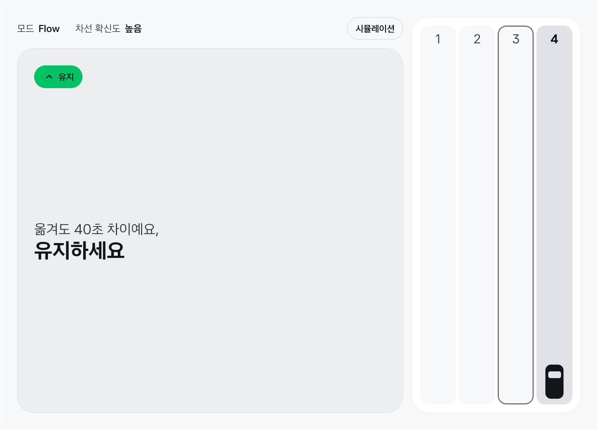 | 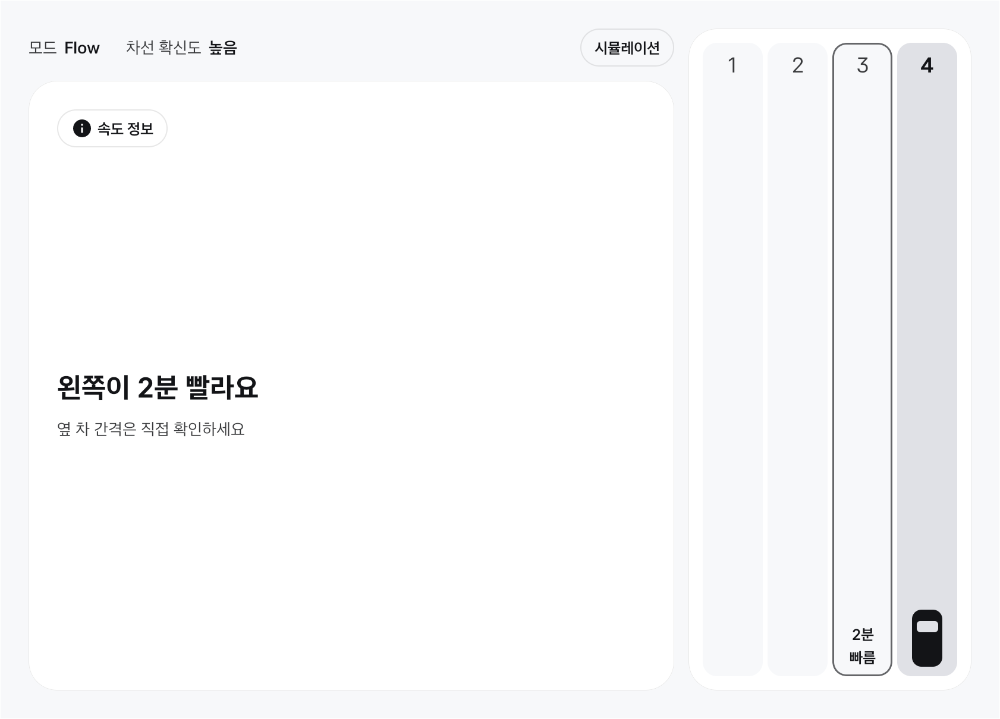 |

| 위험 지수 | 동승자 | Stay (야간) |
| --- | --- | --- |
| 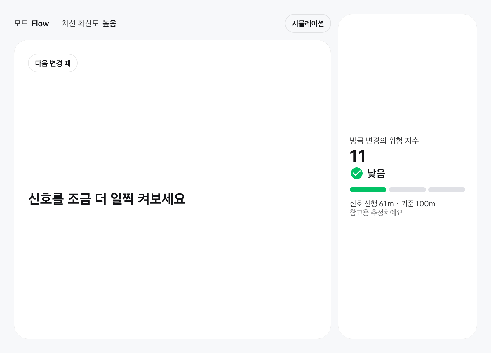 | 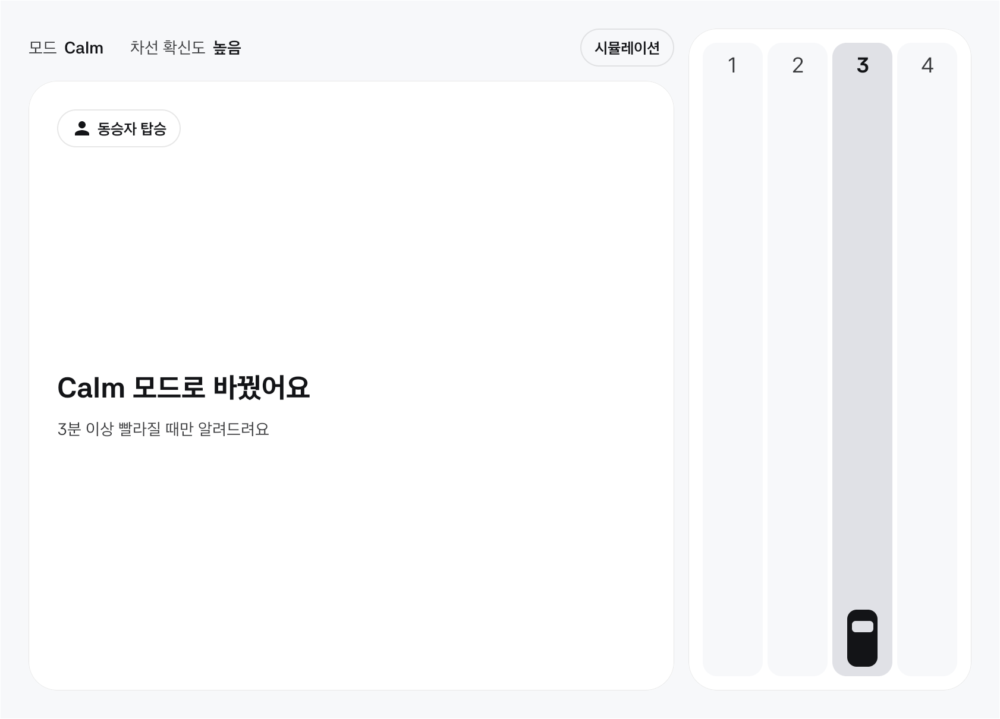 | 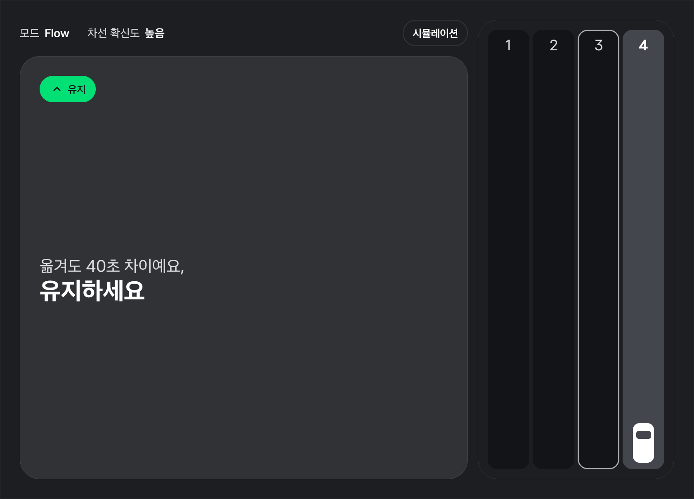 |

예시 도로 (에뮬레이터 Virtual Console 로 기어·차속·방향지시등·조향각·착석을 넣었고, 차로별 속도만 예시 값):

| 대기 | 변경 정보 | 위험 지수 |
| --- | --- | --- |
| 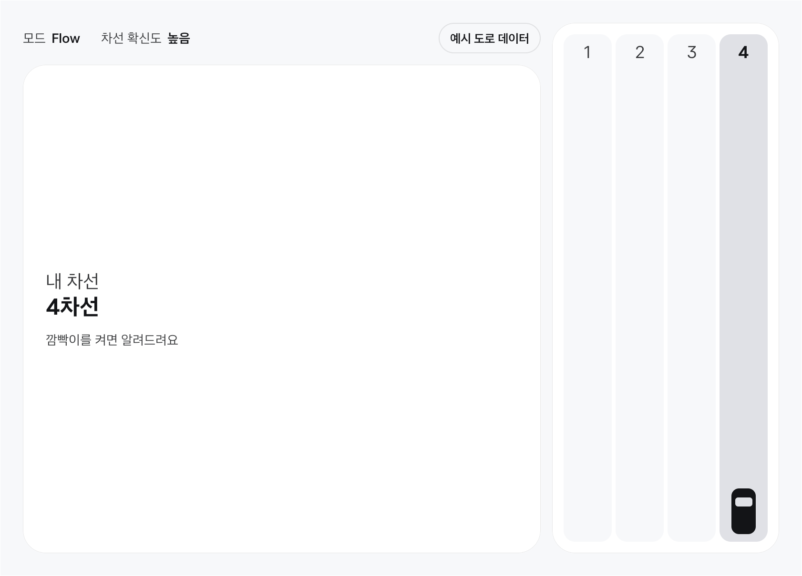 | 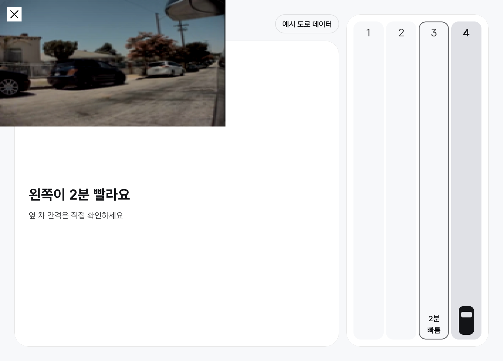 | 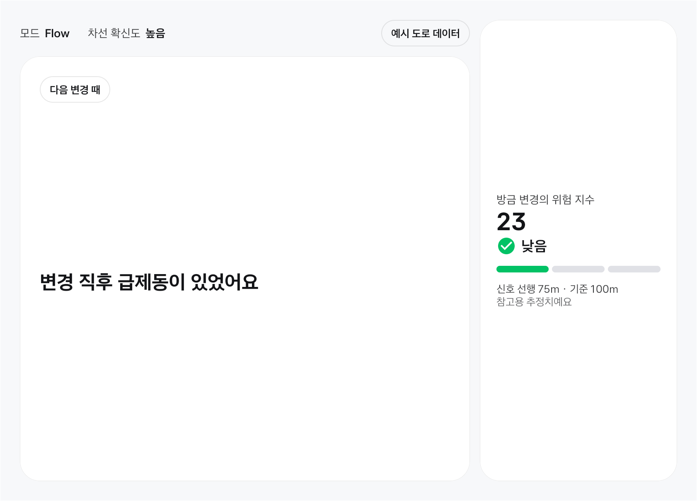 |

| 동승자 | 주행 후 리포트 |
| --- | --- |
| 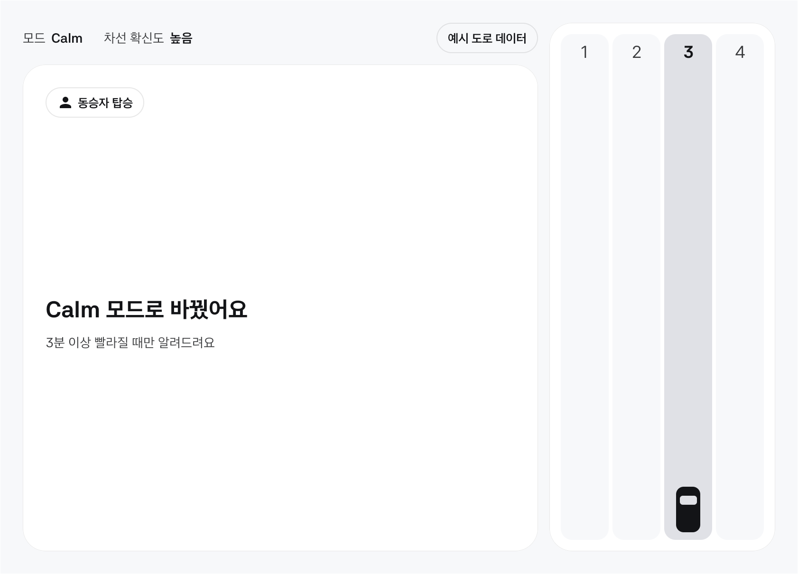 | 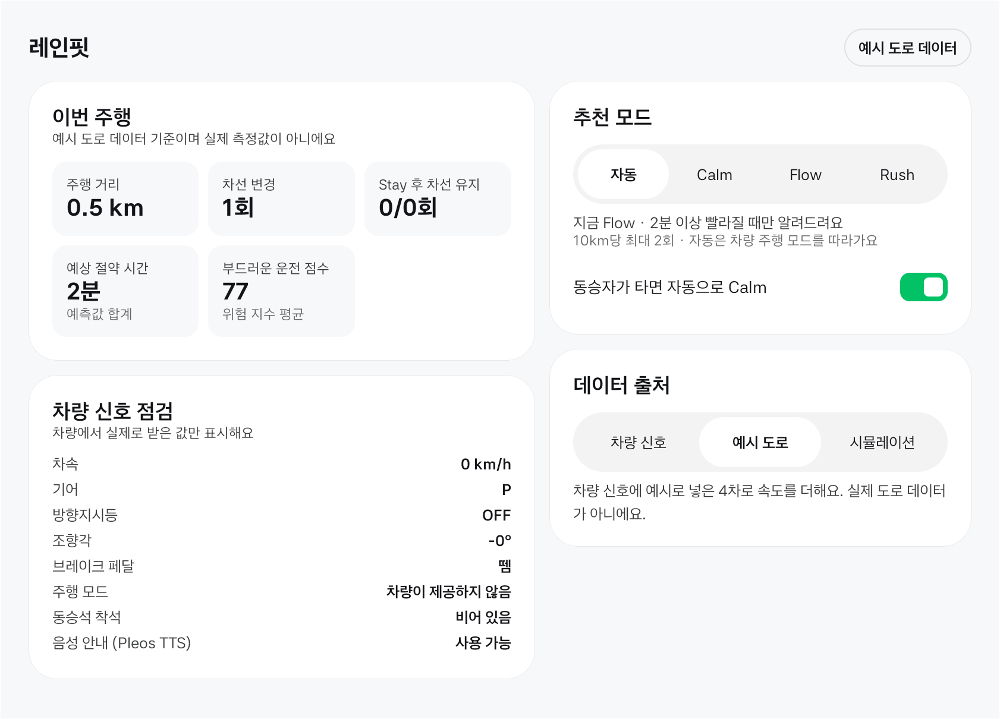 |

변경 정보 캡처 왼쪽 위의 카메라 화면은 방향지시등을 켜면 시스템이 띄우는 사각지대 카메라 창이다. 앱이 그린 것이 아니고 앱이 끌 수도 없다. 상태 줄이 가려지지만 문장은 가려지지 않는다.

주차 화면과 세로 윈도우:

| 주차 | 주차 (야간) | 세로 Stay | 세로 위험 지수 |
| --- | --- | --- | --- |
| 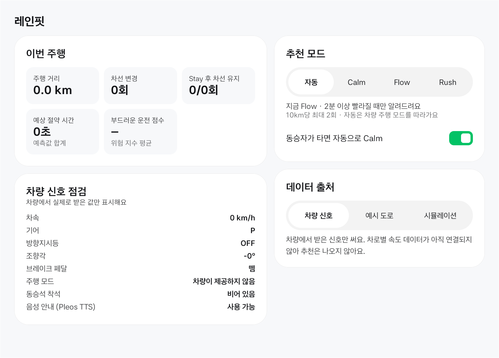 | 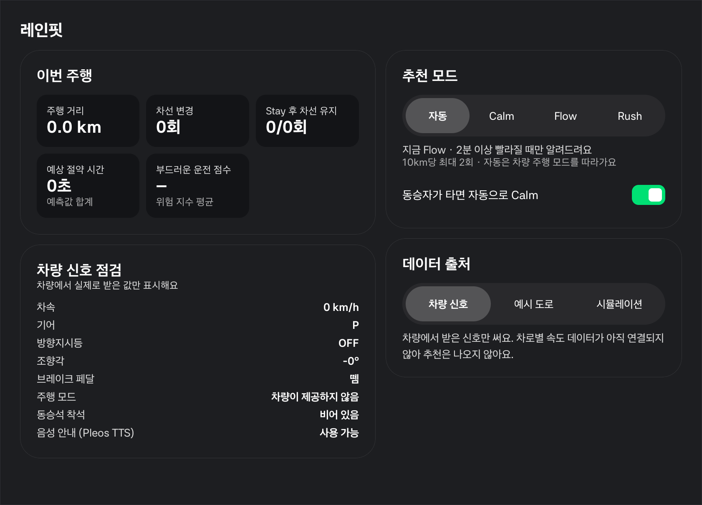 | 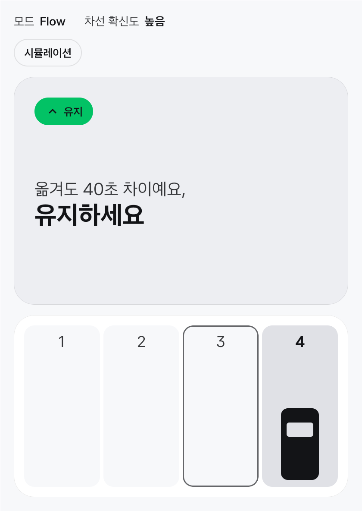 | 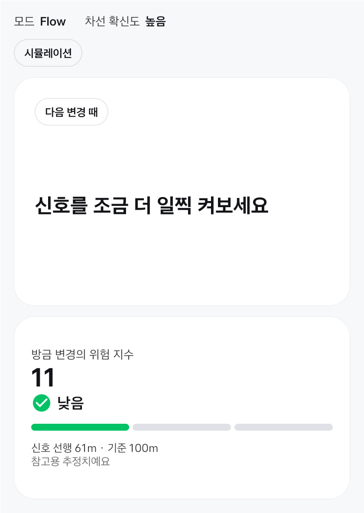 |
