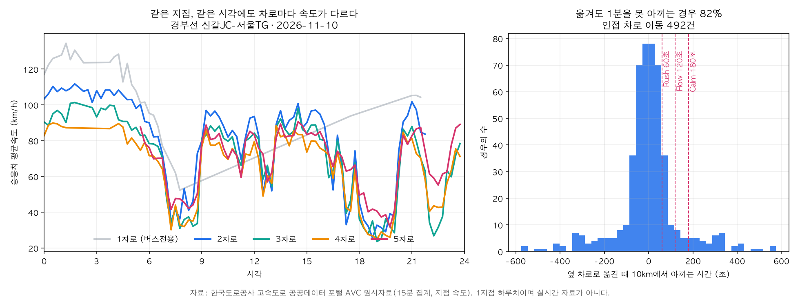
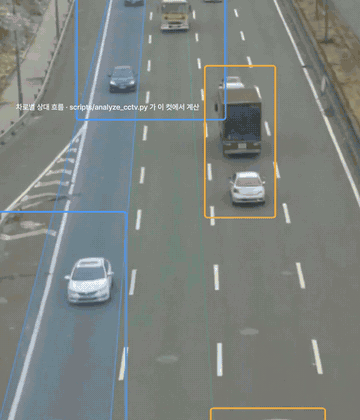

# LaneFit 데이터 분석과 백테스트

LaneFit의 차로 속도 프로필은 한국도로공사 공개 자료로 만듭니다. 이 문서는 자료, 프로필을 만드는 방법, 백테스트 결과, 앱이 프로필을 쓰는 방식, 재현 명령을 다룹니다. 3절의 수치는 `scripts/lane_profile.py`가 계산해 [lane-profile-backtest.json](lane-profile-backtest.json)에 기록한 값입니다.

## 1. 데이터

| 항목 | 내용 |
| --- | --- |
| 출처 | 한국도로공사 고속도로 공공데이터 포털 AVC 원시자료 OpenAPI (`https://data.ex.co.kr/openapi/avcinfo/avcOg15DataList`) |
| 단위 | 검지 지점·차로별 15분 집계. 지점 속도의 15분 평균입니다 |
| 인증키 | 포털 문서에 실린 공개 샘플 키(`key=test`)를 사용합니다 |
| 기간 | 2026-10-28 ~ 2026-11-11, 15일 (평일 11일, 주말 4일) |
| 노선 | 경부선(노선번호 0010) 4개 지점 |
| 사용 필드 | 차로 번호(`crgwNo`), 집계 시각(`totlHhmm`), 승용차 평균속도(`avgSped1`), 승용차 교통량(`trfv1`), 버스 교통량(`trfv2`) |

| 지점 ID | 구간 | 이정 | 차로 수 | 버스전용차로 |
| --- | --- | --- | --- | --- |
| 0010AVI3908 | 기흥IC→수원신갈IC | 390.76km | 5 | 1차로 |
| 0010AVI3917 | 수원신갈IC→기흥IC | 391.70km | 5 | 1차로 |
| 0010AVI3962 | 신갈JC→서울TG | 396.15km | 5 | 1차로 |
| 0010AVI3961 | 서울TG→신갈JC | 396.12km | 5 | 1차로 |

원시 응답은 `data/raw/ex-avc-lane-15min/`에 지점·날짜별 파일로 저장합니다. 4개 지점 15일치로 60개 파일입니다.

## 2. 방법

### 2.1 칸 걸러 내기

- 15분 동안 승용차가 20대 미만인 칸은 평균속도를 사용하지 않습니다(`MIN_CARS = 20`).
- 07:00~21:00에 버스 교통량 합계가 승용차 교통량 합계보다 많은 차로는 버스전용차로로 보고 제외합니다(`BUS_HOURS`). 4개 지점 모두 1차로가 해당합니다.

### 2.2 프로필

프로필 한 칸은 지점, 평일·주말, 15분 칸(하루 96개), 차로로 정해집니다. 값은 같은 조건에 해당하는 날짜들의 승용차 평균속도 중앙값입니다. 값이 3일치 미만인 칸은 비워 둡니다(`MIN_DAYS = 3`).

### 2.3 10km 이득

옆 차로로 옮겼을 때 10km에서 아끼는 시간은 다음 식으로 계산합니다. 속도는 km/h이고 5km/h 미만은 5km/h로 계산합니다.

```text
이득(초) = (10 / 내 차로 속도 − 10 / 옆 차로 속도) × 3600
```

예를 들어 내 차로가 60km/h, 옆 차로가 80km/h이면 이득은 150초입니다.

### 2.4 수준 맞추기

프로필은 평소 값이므로 그날의 수준에 맞춘 뒤 비교합니다. 내 차로의 실제 속도를 내 차로의 프로필 값으로 나눈 비율을 0.4~1.3배 범위로 제한하고, 이 비율을 모든 차로의 프로필 값에 곱합니다(`SCALE = (0.4, 1.3)`). 앱도 같은 식을 사용합니다.

### 2.5 백테스트

하루를 빼고 만든 프로필로 그날을 맞혀 보는 방식(leave-one-day-out)입니다.

1. 평가할 날짜를 하나 고르고 같은 종류(평일 또는 주말)의 나머지 날짜로 프로필을 만듭니다.
2. 그날의 15분 칸마다, 각 차로에서 인접한 왼쪽·오른쪽 차로로 옮기는 경우를 한 건으로 셉니다. 버스전용차로가 포함된 이동, 그날 옆 차로의 속도가 없는 이동, 프로필이 빈 칸은 제외합니다.
3. 예측 이득은 수준을 맞춘 프로필 속도로, 실제 이득은 그날의 실제 속도로 계산합니다.
4. 예측 이득이 모드 기준(Rush 60초, Flow 120초, Calm 180초) 이상이면 "변경 안내", 미만이면 "유지"로 판단하고 실제 이득으로 같은 판단을 내린 결과와 비교합니다.

백테스트는 이득 기준에 따른 판단을 평가합니다. 앱의 나머지 조건(차선 신뢰도 0.6 이상, 현재 차로 60초 이상 유지, 10km당 변경 안내 횟수 상한)은 변경 안내를 줄이는 방향으로만 작용합니다.

## 3. 결과

4개 지점, 15일, 10km 기준, 버스전용차로 제외, 15분당 승용차 20대 이상인 칸의 결과입니다.

### 3.1 전체

| 항목 | 값 |
| --- | --- |
| 인접 차로 이동 | 24,962건 |
| 실제 이득 중앙값 | 0.0초 |
| 이득이 없거나 손해 | 50.0% |
| 이득 1분 미만 | 86.9% |
| 예측 오차 중앙값 | 23.9초 |

### 3.2 모드별

| 모드 | 판단 일치율 | 변경 안내 건수(비율) | 그중 실제 기준 이상 | 손해 아님 | 유지 판단 정확 | 실제 기준 초과 비율 |
| --- | --- | --- | --- | --- | --- | --- |
| Rush(60초) | 87.4% | 2,525 (10.1%) | 52.6% | 78.5% | 91.3% | 13.1% |
| Flow(120초) | 94.4% | 1,091 (4.4%) | 57.0% | 82.1% | 96.1% | 6.2% |
| Calm(180초) | 96.4% | 686 (2.7%) | 62.1% | 85.9% | 97.3% | 4.3% |

| 열 | 뜻 |
| --- | --- |
| 판단 일치율 | 예측과 실제가 기준의 같은 쪽에 있는 비율 |
| 변경 안내 건수(비율) | 예측 이득이 기준 이상인 건수와 전체에서의 비율 |
| 그중 실제 기준 이상 | 변경 안내 가운데 실제 이득도 기준 이상인 비율 |
| 손해 아님 | 변경 안내 가운데 실제 이득이 0초보다 큰 비율 |
| 유지 판단 정확 | 유지 판단 가운데 실제 이득이 기준 미만인 비율 |
| 실제 기준 초과 비율 | 전체 가운데 실제 이득이 기준 이상인 비율 |

### 3.3 지점별

| 지점 | 구간 | 이동 건수 | 1분 미만 | 오차 중앙값 | Flow 일치율 |
| --- | --- | --- | --- | --- | --- |
| 3908 | 기흥IC→수원신갈IC | 4,612 | 91.5% | 20.4초 | 97.0% |
| 3917 | 수원신갈IC→기흥IC | 6,326 | 96.1% | 15.5초 | 98.8% |
| 3962 | 신갈JC→서울TG | 7,584 | 83.4% | 29.4초 | 92.8% |
| 3961 | 서울TG→신갈JC | 6,440 | 78.6% | 36.2초 | 90.1% |

지점별 모드 수치는 [lane-profile-backtest.json](lane-profile-backtest.json)의 `sites` 항목에 있습니다.

### 3.4 해석

- 옆 차로로 옮겨도 86.9%는 1분을 아끼지 못하고 절반은 이득이 없거나 손해입니다. 그래서 LaneFit의 기본 답은 "유지"입니다.
- 유지 판단은 Flow 모드에서 96.1%, Calm 모드에서 97.3% 맞습니다.
- 변경 안내는 Flow 모드에서 전체의 4.4%에만 나오고 그중 82.1%는 손해가 아닙니다.
- 기준이 높은 모드일수록 변경 안내가 줄고 판단 일치율이 올라갑니다.

## 4. 앱에서의 사용

`build` 명령이 프로필을 `app/src/main/assets/lane_profile.txt`로 내보내고 앱은 이 파일을 `engine/RoadProfile.kt`로 읽습니다.

| 줄 | 형식 | 내용 |
| --- | --- | --- |
| 구간 | `S\|지점 ID\|구간 이름\|시작 위도\|시작 경도\|끝 위도\|끝 경도\|차로 수\|버스전용차로` | 시작에서 끝으로 가는 방향이 진행 방향입니다 |
| 평일 | `W\|칸 번호\|1차로,2차로,…` | 15분 칸(0~95)의 차로별 속도(km/h, 정수) |
| 주말 | `E\|칸 번호\|1차로,2차로,…` | 위와 같습니다 |

- 구간은 검지 지점 앞뒤 1.5km입니다. 좌표는 이정 388.0km, 393.2km, 397.4km 지점의 좌표를 이정으로 직선 보간한 값입니다.
- 버스전용차로와 자료가 없는 칸은 값을 비워 둡니다. 앱은 속도가 없는 차로로 안내하지 않습니다.
- `RoadSection.contains`는 위치가 구간 직선에서 좌우 200m 이내이고 진행 방향이 구간 방향과 40도 이내일 때 구간 안으로 판단합니다.
- 앱은 1초마다 한국 표준시 기준의 15분 칸과 평일·주말 구분으로 프로필 행을 불러옵니다.
- `RoadMatcher.laneSpeeds`는 내 차로 실제 속도의 1분 이동평균을 내 차로 프로필 값으로 나눈 비율(0.4~1.3배)을 모든 차로에 곱합니다. 2.4절과 같은 식입니다.
- 위치가 10초 넘게 갱신되지 않거나 구간 밖이면 차로 속도를 비워 두며 이때 앱은 변경을 안내하지 않습니다.
- 맞춘 차로 속도는 `Recommender.kt`의 `advise`로 전달되고 10km 기준으로 2.3절의 식을 계산합니다.

## 5. 하루 예시 분석

`scripts/analyze_avc.py`는 한 지점의 하루치 자료로 같은 10km 이득을 계산하고 그림을 그립니다. 프로필을 거치지 않고 그날의 실제 속도끼리 비교합니다.



하루 예시: 경부선 신갈JC–서울TG 지점(0010AVI3962), 2026-11-10. 왼쪽은 시각별 차로 속도, 오른쪽은 인접 차로 이동의 10km 이득 분포입니다.

- 인접 차로 이동 492건 중 81.5%가 1분 미만입니다.
- 요약은 [avc-lane-gap.json](avc-lane-gap.json), 그림은 `docs/media/lane-gap.png`에 있습니다.
- 이 절은 한 지점의 하루 예시입니다. 앱의 프로필과 3절의 수치는 4개 지점 15일치로 계산한 값입니다.

## 6. 도로 CCTV 흐름 분석 도구

`scripts/analyze_cctv.py`는 고정 CCTV 영상에서 컴퓨터 비전으로 차로별 흐름을 읽는 분석 도구입니다. 차로별 통행속도 자료가 15분 평균이라면, 이 도구는 영상에서 차로끼리의 상대 흐름을 프레임 단위로 읽습니다.

<p align="center"></p>

위 화면은 AI로 만든 연출 영상입니다. 겹쳐 그린 차로 영역과 상자, 막대는 이 도구가 이 컷에서 계산한 값이며 실제 도로의 측정값이 아닙니다.

- 차로마다 사다리꼴 영역을 정하고 연속한 프레임의 광학 흐름(Farneback)에서 움직이는 화소를 골라 차로별 중앙 속도를 구합니다.
- 통과 대수는 차로 가운데 검지선의 점유가 꺼졌다 켜지는 횟수로 셉니다.
- 속도는 화면상 값(px/s)입니다. 같은 높이 띠에서 차로끼리 견주는 상대 속도입니다.
- 차로 영역은 카메라마다 스크립트의 `CAMERAS`에 지정합니다.
- 자체 검증은 정답을 아는 합성 3차로 영상(120·240·60 px/s, 6·8·3대)으로 속도 오차 15% 이내와 통과 대수 일치를 확인합니다. 세 차로 모두 속도 오차 0%, 통과 대수 일치로 통과합니다.
- 야간 영상에서는 전조등 빛 번짐이 옆 차로 영역의 움직임으로 잡혀 통과 대수가 실제보다 많게 나옵니다.
- 영상을 분석하면 요약을 `docs/research/cctv-lane-flow.json`에, 그림을 `docs/media/cctv-lane-flow.png`에 씁니다.
- 영상 원본은 저장소에 포함하지 않습니다.
- 앱의 판단은 차량 신호와 차로 속도 프로필로 내립니다. 음성 인식과 음성 합성은 Pleos SDK의 온디바이스 모드로 동작합니다.

## 7. 재현

프로필과 백테스트입니다. 표준 라이브러리만 사용합니다.

```sh
python3 -I scripts/lane_profile.py fetch
python3 -I scripts/lane_profile.py build
```

- `fetch`는 4개 지점 15일치를 `data/raw/ex-avc-lane-15min/`에 받습니다. 요청 사이에 1초를 쉬고 이미 받은 파일은 건너뜁니다.
- `build`는 `app/src/main/assets/lane_profile.txt`와 `docs/research/lane-profile-backtest.json`을 새로 쓰고 결과를 출력합니다.

하루 예시 분석입니다. `fetch`로 받은 같은 날짜·지점 파일을 입력 이름으로 복사해 사용합니다.

```sh
cp data/raw/ex-avc-lane-15min/avc_20261110_0010AVI3962.json \
   data/raw/ex-avc-lane-15min/avc_20261110_site-0010AVI3962_all-day.json
uv run -q --with matplotlib python -I scripts/analyze_avc.py
```

도로 CCTV 흐름 분석 도구입니다. 첫 명령은 자체 검증이고 둘째 명령은 `data/raw/its-cctv/jukjeon/clip.mp4`에 둔 영상을 분석합니다.

```sh
uv run -q --with opencv-python-headless --with numpy python -I scripts/analyze_cctv.py --selftest
uv run -q --with opencv-python-headless --with numpy --with matplotlib python -I scripts/analyze_cctv.py data/raw/its-cctv/jukjeon/clip.mp4
```
