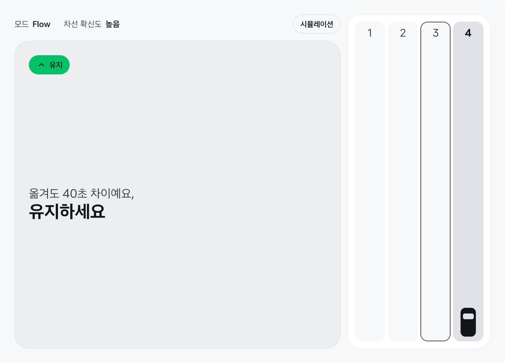
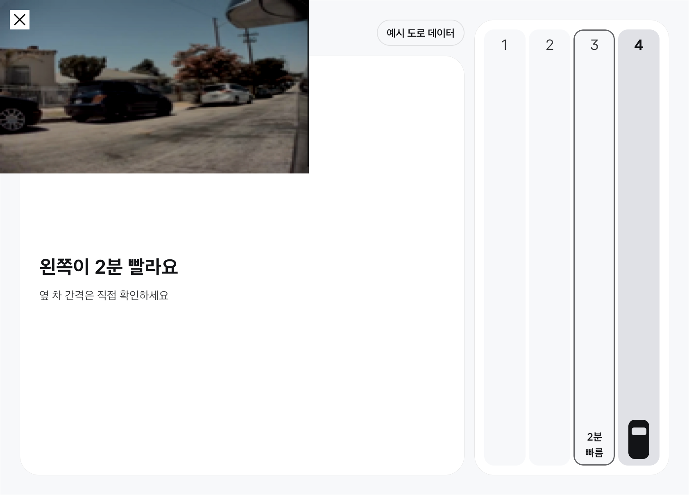
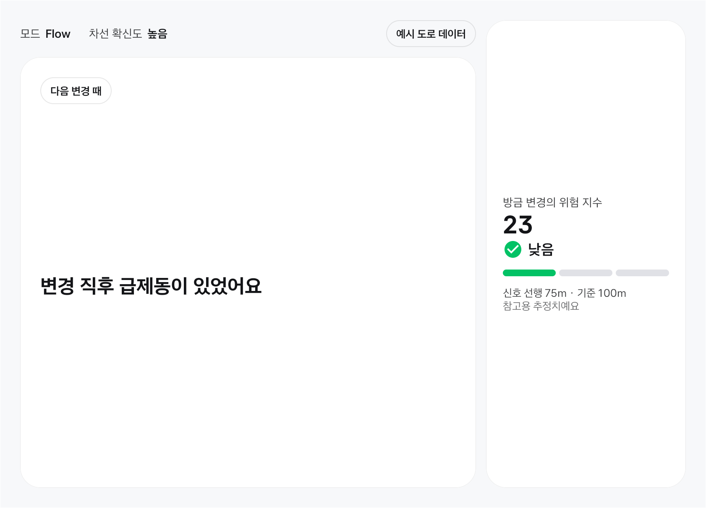
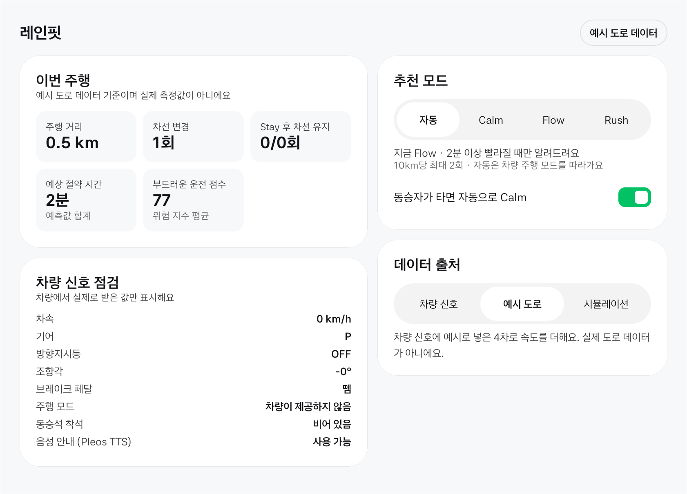

# LaneFit (레인핏) 앱 프로젝트 소개

공식 접수양식 "02 앱 프로젝트 소개 / 심사 자료"의 1~8번 항목에 들어가는 본문이다. `scripts/fill_form.py`가 이 파일을 읽어 양식을 채운다. 양식 규정에 따라 이름, 연락처, 소속은 적지 않는다. `{{…}}`는 제출 직전에 채우는 값이다.

## 1. 앱 한 줄 소개

방향지시등을 켜는 순간 "옮길 만한지"를 한 문장으로 답하고, 차선을 바꾼 뒤에는 얼마나 안전하게 바꿨는지 알려 주는 Pleos Connect 차선 비서.

- 출품 분야: 안전 운전
- 이 앱이 가장 자주 하는 말: "옮겨도 40초 차이예요, 유지하세요"
- 차량을 제어하지 않는다. 차량 신호를 읽기만 한다.

## 2. 기획 배경

### 출발점이 된 두 장면

매일 아침 도시고속도로. 옆 차선이 빨라 보여서 옮겼더니 방금 떠난 차선이 뚫린다. 다시 옮긴다. 도착해 보면 몇 번을 바꿨는지 기억도 안 나고, 그래서 빨리 왔는지도 모르겠다.

아이를 태우고 가는 길. 출구를 앞두고 급하게 끼어들었다. 뒤차가 경적을 울렸고 아이가 놀랐다. 방향지시등을 켜긴 했는데, 충분히 일찍 켰는지는 알 방법이 없다.

### 주목한 불편

- 차선을 바꿀지 말지를 감으로 정한다. 옆 차선이 지금 빨라 보이는 것과 앞으로 몇 km 동안 빠른 것은 다른 문제인데, 운전자는 눈앞의 흐름밖에 볼 수 없다.
- 내비게이션의 차로 안내는 "어느 차로로 가야 하는가"(회전, 진출 방향)에 답한다. "지금 옮기면 이득이 있는가"에는 답하지 않는다.
- 자기 차선 변경 습관을 돌아볼 방법이 없다. 방향지시등을 얼마나 일찍 켰는지, 핸들을 급하게 돌렸는지, 바꾼 직후 급하게 밟았는지는 차만 알고 운전자는 모른다.

### 왜 해결해야 하는가

차선 변경은 옆 차로의 차와 가까워지는 조작이다. 이득이 거의 없는 변경을 줄이면 그런 순간의 횟수 자체가 줄어든다. 도로교통법 시행령 별표 2는 진로를 바꾸기 전 일반도로 30m, 고속도로 100m 이상 지점부터 신호를 하도록 정하고 있다. 하지만 운전 중에 이 거리를 지켰는지 알려 주는 도구는 없다.

### 왜 차 안이어야 하는가

방향지시등, 조향각, 브레이크, 주행 모드, 좌석 착석은 차량과 연동되지 않은 스마트폰 앱이 읽을 수 없는 신호다. Pleos Connect 앱은 Vehicle SDK로 이 신호를 읽는다. 그래서 레인핏은 운전자에게 아무것도 입력시키지 않는다. 운전자가 원래 하던 동작, 방향지시등을 켜는 것이 곧 질문이 된다.

레인핏은 내비게이션을 대신하지 않는다. 어떤 내비게이션을 쓰든 그 옆에서 차선 단위 판단과 안전 코칭만 더한다.

## 3. 앱 주요 기능 및 차량 특화 요소

### 핵심 기능

| 기능 | 하는 일 | 줄이려는 문제 |
| --- | --- | --- |
| Stay 카드 | 옮겨도 이득이 모드 기준에 못 미치면 "옮겨도 40초 차이예요, 유지하세요"라고 답한다. 변경 안내보다 Stay가 훨씬 자주 나오도록 설계했다 | 이득 없는 차선 변경 |
| 깜빡이가 곧 질문 | 방향지시등을 켠 순간을 "바꾸려는 의도"로 읽고, 그때 한 번, 한 문장으로 답한다. 화면 터치도 음성 호출도 없다 | 주행 중 조작과 주의 분산 |
| 내 차선 자동 추정 | 진입로 합류처럼 차선이 확실한 지점을 기준점으로 잡고, 그 사이는 조향각과 차속으로 차선 이동을 추적한다. 확신도가 낮으면 아무 말도 하지 않는다 | 차선을 직접 입력하는 부담 |
| 차선 변경 위험 지수 | 차선을 바꿀 때마다 0~100점으로 평가하고 한 줄로 코칭한다. 예: "신호를 조금 더 일찍 켜보세요" | 자기 습관을 알 수 없음 |
| 드라이브 모드 | Calm, Flow, Rush. 차량 주행 모드를 따라 자동으로 바뀌고, 운전자가 고정할 수도 있다 | 운전자마다 다른 기준 |
| 동승자 모드 | 동승자가 타면 Calm으로 바꾼다. 현재 구현은 조수석 착석 신호를 읽고, 뒷좌석은 다음 단계다 | 가족을 태운 주행의 불안 |
| 주행 리포트 | 주차(P)하면 Stay 안내 후 유지한 횟수, 차선 변경 횟수, 부드러움 점수를 보여 준다 | 덜 바꾼 운전이 보상받지 못함 |

### 추천 기준

| 모드 | 연동되는 조건 | 변경을 안내하는 최소 예상 단축 | 10km당 변경 안내 상한 |
| --- | --- | --- | --- |
| Calm | 주행 모드 ECO, 또는 동승자 탑승 | 3분 | 1회 |
| Flow (기본) | 주행 모드 NORMAL | 2분 | 2회 |
| Rush | 주행 모드 SPORT | 1분 | 3회 |

표의 숫자는 검증 전의 초기 설계값이고 백테스트 결과로 조정한다. 어떤 모드에서도 차선을 바꾼 뒤 60초 동안은 다시 변경을 안내하지 않는다. 직전 변경의 위험 지수가 "높음"이면 한 단계 보수적인 모드로 내려간다.

### 위험 지수

| 항목 | 계산 | 기준의 출처 |
| --- | --- | --- |
| 신호 선행 거리 | 차속 × (점등부터 차선 이동까지의 시간). 고속도로 100m, 일반도로 30m에 못 미친 만큼 감점 | 도로교통법 시행령 별표 2 |
| 신호 없음 | 방향지시등 없이 조향만으로 이동하면 가장 큰 감점 | 같은 조항 |
| 너무 빠른 이동 | 점등 후 1초 안에 이동 | 초기 설계값 |
| 급조향 | 변경 중 조향각 변화율 | 초기 설계값 |
| 변경 후 급제동 | 변경 뒤 3초 안의 급감속 | 초기 설계값 |
| 연속 변경 | 직전 60초 안의 다른 변경 횟수 | 초기 설계값 |

계산 예: 시속 100km는 초속 약 27.8m다. 100m를 지키려면 방향지시등을 켠 뒤 약 3.6초가 지나서 차선을 옮겨야 한다. 차속과 점등 시각만 있으면 계산된다. 점수 구간은 30점 미만 "낮음", 60점 미만 "보통", 그 이상 "높음"이다. 가중치는 실주행 자료로 맞출 값이다.

### 차량 특화 요소

| 차량 신호 | 레인핏에서의 쓰임 |
| --- | --- |
| 방향지시등 | 질문의 시작점. 신호 선행 거리 계산 |
| 조향각 | 차선 이동 추적. 급조향 판단 |
| 브레이크 | 변경 후 급제동 판단 |
| 주행 모드 | 추천 강도 자동 전환 |
| 좌석 착석 | 동승자 모드 |

다섯 신호 모두 차량과 연동되지 않은 스마트폰 앱은 읽을 수 없다. 레인핏의 핵심 기능은 이 신호가 없으면 성립하지 않는다.

### 안전 원칙

- 속도 정보만 말한다. 옆 차와의 간격이 충분한지, 지금 들어가도 되는지는 판단하지 않는다. 그 판단은 운전자가 한다.
- 한 문장만, 점등 직후 한 번만 말한다.
- 내 차선에 대한 확신도가 낮으면 침묵한다.
- 경로상 출구나 분기점 때문에 켠 방향지시등에는 답하지 않는다.
- 주행 중에는 터치할 것이 없다. 버튼과 설정은 주차 화면에만 있다.
- 리포트의 절약 시간은 예측값의 합이다. 과금 근거로 쓰지 않는다. 많이 바꿀수록 돈이 되는 구조를 만들지 않기 위해서다.

## 4. 주요 사용 시나리오

### 시나리오 1. 출근길, 옆 차선이 빨라 보일 때

도시고속도로로 출퇴근하는 직장인.

1. 진입로로 합류한다. 레인핏은 이 지점을 "맨 오른쪽 차로"라는 기준점으로 잡는다. 운전자는 아무것도 누르지 않는다.
2. 옆 차선이 빨라 보여 왼쪽 방향지시등을 켠다.
3. 레인핏이 앞으로 10km 구간의 예상 차이를 계산한다. 40초다. Flow 모드 기준인 2분에 못 미친다.
4. "옮겨도 40초 차이예요, 유지하세요." 화면에는 같은 문장이 크게 한 번 뜬다.
5. 운전자는 방향지시등을 끄고 그대로 간다. 리포트에 "Stay 후 유지 1회"가 쌓인다.

### 시나리오 2. 옮길 만할 때, 그리고 옮긴 뒤

같은 운전자, 몇 분 뒤.

1. 내 차로가 느려진다. 다시 왼쪽 방향지시등을 켠다.
2. 이번에는 예상 차이가 2분 30초다. "왼쪽이 2분 빨라요."
3. 운전자가 주변을 확인하고 차선을 옮긴다. 레인핏은 조향각으로 이동을 감지하고 현재 차로를 4차로에서 3차로로 고친다.
4. 3초 뒤 위험 지수 카드가 뜬다. 방향지시등을 켠 뒤 약 60m를 달리고 옮겼다. 고속도로 기준 100m에 못 미친다. "신호를 조금 더 일찍 켜보세요."

### 시나리오 3. 아이를 태운 길

주말에 아이와 함께 나서는 부모.

1. 조수석에 아이가 탄다. 좌석 착석 신호가 들어온다. (뒷좌석 착석은 아직 읽지 않는다.)
2. "동승자가 탔어요, Calm 모드로 바꿀게요." 이제 3분 이상 차이 날 때만 변경을 안내한다.
3. 설정에서 "동승자가 타면 자동으로 Calm"을 끌 수 있다. 운전자가 모드를 직접 고정하면 그 선택이 우선한다.

좌석 착석 신호는 탑승 여부만 알려 준다. 아이인지 어른인지는 구분하지 못한다. 그래서 자동 전환 여부를 설정으로 열어 두었다.

### 시나리오 4. 도착 후

기어를 P에 두면 리포트 화면으로 바뀐다. 이번 주행에서 Stay 안내를 몇 번 받았고 그중 몇 번 유지했는지, 차선을 몇 번 바꿨는지, 부드러움 점수가 몇 점인지 보여 준다. 빨리 간 것이 아니라 덜 바꾼 것과 부드럽게 바꾼 것을 칭찬한다.

## 5. 개발 계획

### 개발 범위

Kotlin과 Jetpack Compose로 만든다. 기준 환경은 Pleos Connect Emulator v2.1.0(Android 14, API 34, 2560×1440, 160dpi)이다. 이 에뮬레이터를 개발 장비에 설치해 실행하고 있다. 판단 로직(차선 추정, 위험 지수, 추천, 모드)은 Android에 의존하지 않는 순수 Kotlin으로 분리해 JVM 단위 테스트로 검증한다.

- 차량 신호 어댑터: Pleos SDK와 Android Automotive API에서 신호를 받아 한 가지 표본 형식으로 바꾼다.
- 주행 세션: 표본을 받아 화면 상태와 한 문장 음성을 만든다. 차량에 명령을 보내는 코드는 없다.
- 화면: 주행 중에는 문장 하나와 차선 그림만 보여 준다. 설정과 리포트는 주차 화면에 둔다.
- 디자인: Pleos Connect 디자인 가이드의 색 토큰, 타입 스케일, 컴포넌트 치수를 따른다. 주야간 전환과 가로·세로 윈도우를 모두 지원한다. 적용한 값과 확인 범위는 저장소의 docs/design/DESIGN.md에 적었다.

### SDK/API 사용 계획

공모전에서 제공되는 다섯 개 SDK만 쓴다. 이번 제출본에 들어간 것은 Vehicle과 TextToSpeech 두 개다.

| SDK | 읽는 것 | 권한 | 쓰임 | 제출본 |
| --- | --- | --- | --- | --- |
| Vehicle 2.3.2 | 방향지시등 | pleos.car.permission.CAR_LIGHTS | 질문의 시작점, 신호 선행 거리 | 구현 |
| Vehicle 2.3.2 | 조향각, 브레이크, 주행 모드 | pleos.car.permission.CAR_DRIVE | 차선 이동 추적, 급제동 판단, 모드 전환 | 구현 |
| Vehicle 2.3.2 | 좌석 착석 (조수석) | pleos.car.permission.CAR_SEATS | 동승자 모드 | 구현 |
| TextToSpeech 3.3.1 | 해당 없음 | pleos.car.permission.TTS_SERVICE | 한 문장 음성 안내 | 구현 |
| NaviHelper 3.0.5 | 경로 시작, 경로 계산 완료 등 경로 이벤트 | pleos.car.permission.NAVI_ROUTE | 경로 때문에 켠 방향지시등 구분(제공되는 경로 정보 범위는 확인 중) | 계획 |
| FusedLocation 1.1.3 | 위치, 진행 방향 | pleos.car.permission.FUSED_LOCATION | 도로 구간과 진출입로 매칭, 차속 대체 계산 | 계획 |
| SpeechToText 3.3.1 | 운전자 음성 | pleos.car.permission.STT_SERVICE | "지금 바꿀까?" 같은 보조 질문. 기본 동작은 방향지시등이다 | 계획 |

- 차속과 기어: Vehicle SDK 2.3.2에는 차속을 읽는 API가 없다. Android Automotive의 CarPropertyManager에서 PERF_VEHICLE_SPEED와 GEAR_SELECTION을 읽는다(권한 android.car.permission.CAR_SPEED, CAR_POWERTRAIN). 에뮬레이터에서는 두 값 모두 받았다. 실차에서 서드파티 앱에 이 권한이 열리는지는 확인하지 못했다. 열리지 않으면 FusedLocation 위치의 시간당 이동 거리로 차속을 계산한다.
- 주행 모드: SDK의 주행 모드 값은 NORMAL, ECO, SPORT 세 가지다. 각각 Flow, Calm, Rush에 대응시킨다. 에뮬레이터는 이 신호를 제공하지 않아 NORMAL(Flow)로 동작한다.
- 경로 정보가 연결되기 전까지는 "경로 때문에 켠 방향지시등"을 구분하지 못한다. 그 판단 자리는 엔진에 있고 단위 테스트로 확인했지만, 입력이 아직 없다.
- 차량 제어 권한(CONTROL 계열)은 요청하지 않는다.

### 차로별 속도 데이터

조사한 범위에서, 차로 번호별 속도는 한국도로공사의 과거 파일로 제공되고, 실시간 공개 API는 구간 또는 차로 유형 단위다. 실시간으로 차로 번호별 속도를 받는 공개 API는 찾지 못했다. 그래서 다음 순서로 추정한다.

1. 과거 차로별 통행속도 파일로 구간, 요일, 시간대별 "차로 간 속도 차" 프로필을 만든다.
2. 실시간 구간 속도로 그 프로필의 수준을 맞춘다.
3. 차이가 작거나 자료가 없는 구간에서는 Stay로 답하거나 침묵한다.

이 추정이 실제와 얼마나 맞는지는 아직 검증하지 못했다. 백테스트는 계획 단계이고, 현재 앱의 차로별 속도는 시뮬레이션용 예시 값이다.

### 구현 현황 (2026-11-12 기준)

| 구성 | 상태 |
| --- | --- |
| 차선 추정 엔진 (기준점, 조향 추적, 확신도) | 구현, 단위 테스트 통과 |
| 차선 변경 위험 지수 | 구현, 단위 테스트 통과 |
| Stay 우선 추천기, 모드 로직 | 구현, 단위 테스트 통과 |
| 주행 세션 (카드, 음성 문장, 리포트 집계) | 구현, 단위 테스트 통과 |
| 66초 시뮬레이션 주행 | 구현. 신호와 속도는 예시 값 |
| 단위 테스트 | 14개 통과 |
| Vehicle SDK 어댑터, TTS, Compose 화면 | 구현. 에뮬레이터에서 신호별로 확인 (아래 표) |
| 기준점 입력 (진입로 합류 인식) | 미구현. 위치와 경로 정보가 필요하다. 지금은 시작 차선을 예시 값으로 준다 |
| 차로별 속도 추정, 백테스트 | 미착수. 데이터 확보 중 |

4번 항목의 시나리오 1~3은 저장소의 66초 시뮬레이션 주행으로 그대로 재현된다. 단위 테스트가 안내 문장의 순서와 리포트 숫자를 검증한다.

### 시뮬레이션과 실제 연동의 구분

앱에는 데이터 출처가 세 가지 있고, 차량 신호만 쓰는 경우가 아니면 화면에 항상 표시된다.

| 출처 | 차량 신호 | 차로별 속도와 시작 차선 |
| --- | --- | --- |
| 차량 신호 | SDK에서 받은 값 | 없음. 그래서 추천이 나오지 않는다 |
| 예시 도로 | SDK에서 받은 값 | 앱에 넣어 둔 4차로 예시 값 |
| 시뮬레이션 | 앱 안의 66초 시나리오 | 같은 시나리오의 예시 값 |

Pleos Connect Emulator v2.1.0에서 Virtual Console로 차량 값을 바꿔 가며 앱까지 전달되는지 확인한 결과다.

| 신호 | 경로 | 에뮬레이터 결과 |
| --- | --- | --- |
| 차속 | AAOS PERF_VEHICLE_SPEED | 수신. 주행 화면 전환과 거리 계산에 반영 |
| 기어 | AAOS GEAR_SELECTION | 수신. P에서 주차 화면, D에서 주행 화면 |
| 방향지시등 | Vehicle SDK | 수신. 점등 직후 카드가 뜬다 |
| 조향각 | Vehicle SDK | 수신. 조향을 한 차로만큼 움직이면 차선 변경으로 감지 |
| 브레이크 페달 | Vehicle SDK | 수신. 변경 직후 급감속을 급제동으로 판정 |
| 조수석 착석 | Vehicle SDK | 수신. Calm 전환 |
| 주행 모드 | Vehicle SDK | 에뮬레이터가 이 속성을 제공하지 않는다. 앱은 "차량이 제공하지 않음"으로 표시하고 NORMAL로 동작 |
| 음성 안내 | TextToSpeech SDK | 초기화 성공. 실제 소리가 나는지는 확인하지 못했다 |

이 주행은 저장소의 scripts/drive_emulator.py로 다시 실행할 수 있다. 확인하지 못한 것은 다음과 같다. 실차에서의 조향각 부호와 좌석 착석 값의 방향, 실차의 신호 주기, 실차에서의 차속 권한. 에뮬레이터의 조향각은 정수 단위로 들어온다.

### 검증 계획

| 단계 | 시점 | 검증 대상 | 방법 |
| --- | --- | --- | --- |
| 1. 과거 데이터 백테스트 | PT 심사 전 | 차로 간 속도 차 추정과 추천의 정확도 | 한국도로공사 차로별 통행속도 파일에서 한 구간을 골라, 과거 시점의 추정을 그 뒤 실제 기록과 비교한다. 비교 기준은 "차로 유지" 전략이다 |
| 2. 에뮬레이터 차선 추정 테스트 | PT 심사 전 | 입력 없는 차선 추정의 일치율 | 정답 차선 순서가 정해진 주행을 재생한다. 방향지시등 누락, 연속 변경, 2차로 진출로를 일부러 섞는다 |
| 3. 실도로 파일럿 | 수상 이후 | 실주행에서의 추정, 추천, 위험 지수 | 소수 운전자의 실차 주행. 영상으로 실제 차선을 표시해 정답으로 쓴다 |

백테스트에서 차로 간 차이가 작게 나오면 그 결과를 그대로 쓴다. "대부분의 변경은 이득이 없다"는 것이 Stay 카드의 근거가 되기 때문이다.

### 한계와 대응

| 한계 | 대응 |
| --- | --- |
| 조향 추적의 오차가 쌓인다 | 차선 이동을 추적할 때마다 확신도가 내려간다. 0.6 미만이면 침묵하고 다음 기준점에서 다시 맞춘다 |
| 방향지시등 없이 바꾸면 추적이 어긋날 수 있다 | 조향각만으로도 이동을 감지하고, 이때 확신도를 더 크게 낮춘다 |
| 진출로가 2차로면 기준점이 흔들린다 | 기준점마다 신뢰도를 다르게 준다 |
| 실시간 차로 번호별 속도가 없다 | 과거 프로필과 실시간 구간 속도를 결합한다. 차이가 불확실하면 Stay 또는 침묵 |
| 좌석 착석은 탑승 여부만 알려 준다 | 자동 Calm 전환을 설정으로 둔다 |

### 일정

- 접수 마감(11월 15일)까지: 에뮬레이터에서 동작하는 앱, 시연 영상, release APK, 저장소 정리
- PT 심사(12월 3~4일) 전: SDK 신호 연동 범위 확대, 백테스트 1차 결과, 에뮬레이터 차선 추정 테스트
- 수상 이후: 실도로 파일럿, 가중치와 모드 기준 조정

### 향후 계획 (이번 제출 범위 밖)

- Gleo AI 연동: Pleos LLM SDK는 공모전 기간에 제공되지 않아 이번 구현에 넣지 않았다. 제공되면 운전자가 Gleo에게 "지금 차선 바꿀까?"라고 물었을 때 레인핏의 판단과 이유를 답하도록 연결한다.
- 주행 보조 정보 활용: 개발 문서에 공개되지 않은 SDK는 쓰지 않았다. 공개되면 차선 변경 중 경고 발생 여부를 위험 지수에 더하고, 차선 인식 결과로 현재 차선을 직접 보정한다.
- 서버 측 흐름 분석: 도로 CCTV 영상에서 차로별 흐름을 추정해 자료가 없는 구간을 메운다.
- 차량 집단 데이터: 사용자가 늘면 익명으로 집계한 차로별 흐름으로 예측을 보정한다.

## 6. 기대효과 및 발전 가능성

### 사용자에게 주는 가치

- 덜 바꿔도 늦지 않는다는 확신. 방향지시등을 켤 때마다 "이득이 얼마인지"를 듣는다.
- 자기 습관을 숫자로 본다. 신호를 몇 m 전에 켰는지 매번 확인하고, 다음 변경에서 고친다.
- 가족이 탔을 때 차가 먼저 조심한다.
- 배울 것이 없다. 방향지시등은 누구나 이미 쓰고 있다.

### Pleos 생태계에 주는 가치

- 내비게이션과 겹치지 않는다. 어떤 내비게이션 앱과도 함께 쓸 수 있는 보완 앱이다.
- 차량 신호가 없으면 만들 수 없는 앱이다. "차에서만 되는 앱"의 사례가 된다.
- 차량을 제어하지 않는 읽기 전용 설계라 제어 권한이 필요 없다.

### 타깃 고객

- 고속도로와 도시고속도로로 출퇴근하는 운전자. 같은 길을 매일 반복하므로 습관형 사용에 맞는다.
- 가족을 태우는 운전자. 동승자 모드의 주 사용자다.
- 장거리, 업무용 차량 운전자.

### 예상 MAU

아래 표의 입력값은 모두 가정이다. 숫자 자체보다 계산 구조를 보이기 위한 것이다.

| 시점 | 국내 Pleos Connect 탑재 차량 (가정) | 고속도로·도시고속 정기 이용 비율 (가정) | 앱 설치율 (가정) | 월간 활성 비율 (가정) | 예상 MAU |
| --- | --- | --- | --- | --- | --- |
| 2027년 말 | 60만 대 | 40% | 10% | 70% | 약 1.7만 |
| 2028년 말 | 150만 대 | 40% | 15% | 70% | 약 6.3만 |
| 2030년 | 500만 대 | 40% | 15% | 70% | 약 21만 |

- 계산식: 탑재 차량 × 정기 이용 비율 × 설치율 × 월간 활성 비율
- 2030년 탑재 차량은 그룹이 발표한 Pleos Connect 약 2,000만 대 적용 목표에 국내 비중 25%를 가정해 잡았다. 2027년과 2028년 대수, 이용 비율, 설치율은 근거 자료가 없는 가정이다.

### Retention Rate

- 목표: 30일 리텐션 40%, 주 3회 이상 사용자 비율 50%. 측정값이 아니라 목표다.
- 근거로 삼는 구조: 출퇴근은 같은 경로를 매일 반복한다. 주행 모드와 방향지시등에 연동되므로 앱을 따로 조작하지 않아도 매 주행에서 동작한다. 주행마다 리포트가 쌓이고, 지난주보다 덜 바꿨는지를 보여 준다.

### 수익 모델 (구상)

| 모델 | 내용 | 판단 |
| --- | --- | --- |
| 월 구독 | 상세 리포트, 반복 경로의 개인화 예측 | 채택 |
| 데이터 제공 | 익명으로 집계한 차로 단위 흐름을 도로 운영 기관과 내비게이션, 물류 사업자에 제공 | 확장 단계에서 검토 |
| 아낀 시간 연동 과금 | 절약한 시간만큼 결제 | 채택하지 않음 |

아낀 시간 연동 과금을 버린 이유는 두 가지다. 차선을 안 바꿨을 때 걸렸을 시간은 측정할 수 없는 가정이다. 그리고 시간을 많이 아낄수록 돈을 버는 구조는 앱이 차선 변경을 부추기게 만든다.

위치 정보를 다루므로 서비스 단계에서는 위치정보법상 신고와 동의 절차, 익명 집계 처리를 갖춘다.

### 서비스 확대 계획

- 출구 대비 안내: 경로상 출구를 앞두고 미리 오른쪽 차로 유지를 권해 막판 끼어들기를 줄인다.
- 전기차 전비 연동: Calm 주행으로 아낀 전력을 보여 준다. 시간 대신 전비로 보상한다.
- 주간, 월간 리포트: 줄어든 차선 변경 횟수와 위험 지수의 추이.
- Gleo AI, 주행 보조 정보, 집단 데이터 연동은 5번 항목의 향후 계획에 적었다.

## 7. 참고자료(선택 · 가산점 부여)

- GitHub 저장소: {{REPO_URL}}
- 최종 커밋 해시: {{COMMIT_HASH}}
- release APK 위치: {{APK_PATH}}
- 시연 영상: {{DEMO_VIDEO_URL}}
- 실행 방법, 테스트 환경, 에뮬레이터 버전과 화면 규격은 저장소 README에 적었다.

### 앱 화면

Pleos Connect Emulator v2.1.0에서 실행한 앱의 화면이다. 설계 시안이 아니다. 화면 속 속도와 시간은 예시 값이다. 주야간, 세로 윈도우를 포함한 전체 캡처는 저장소의 docs/design/screens 에 있다.

 

왼쪽: Stay 카드(시뮬레이션). 앱에서 가장 큰 글자를 쓴다. 오른쪽: 에뮬레이터의 방향지시등 신호에 답한 변경 정보(예시 도로 데이터). 왼쪽 위의 카메라 창은 방향지시등을 켜면 시스템이 띄우는 것이다.

 

왼쪽: 에뮬레이터의 조향각과 브레이크 신호로 계산한 위험 지수와 한 줄 코칭. 오른쪽: 같은 주행을 마치고 P에 둔 뒤의 리포트와 차량 신호 점검 목록.

## 8. 숏폼 링크(선택 · 가산점 없음)

{{SHORTFORM_URL}}
